# ASTROWORLD

An animated **ASTROWORLD theme park** built for the Computer Graphics capstone. It recreates the album world: the giant brass head with its mouth open as the park entrance, the "Greetings from ASTROWORLD" postcard lettering, the blue-sky carnival of the cover, and the starfield and teal coaster of the night artwork. Every course algorithm is implemented by hand in C++.

> **You are on branch `photorealism`: Photorealism – a living, photoreal park (side project).** This README describes the project *as it stands at this stage*. Later stages live on later branches (see the [roadmap](#project-roadmap-and-branches)), and `main` has the latest work.

> **Just switched branches? Rebuild from scratch before running anything.** Git never touches
> `build/` or `output/` (both are in `.gitignore`), so after `git checkout` they still hold the
> programs and images from the last branch you built, including programs this branch doesn't have
> (for example `astroworldGl` on Checkpoint 1). Running them shows work from another stage. Start clean:
>
> ```bash
> rm -rf build && cmake -B build && cmake --build build -j
> ```
>
> Images already in `output/` may also come from another branch: regenerate them rather than trusting them.
> (Without CMake, use the single `g++` command under [Building and running](#building-and-running).)

## This stage: Photorealism – a living, photoreal park (side project)

- The real-time park made photoreal: **PBR** (Cook–Torrance), **shadow mapping**, **HDR** with ACES tone mapping, **bloom** and GPU instancing.
- The inflatable gold head is the entrance, and ~140 visitors walk *through* its mouth into a much bigger park with new rides (wave swinger, pirate ship, teacups, bumper cars). See [the photorealism section](#photorealism--a-living-photoreal-park).

**Run it** (after building):

```bash
./build/astroworldGl               # C cycles viewpoints (try THE GATE), X shadows, B bloom, H help
```

**What you should see:**

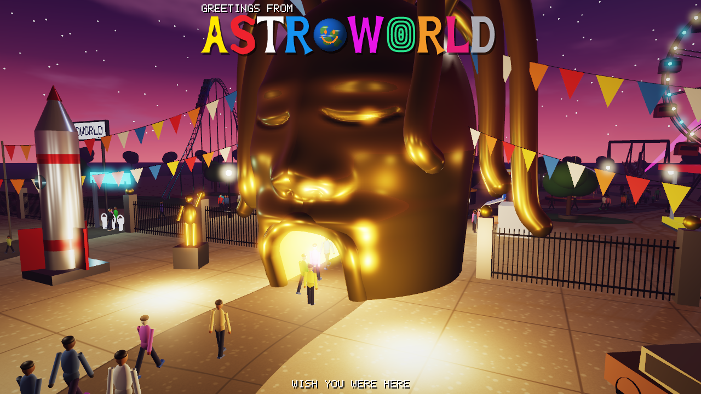

| Day | Night |
|---|---|
| 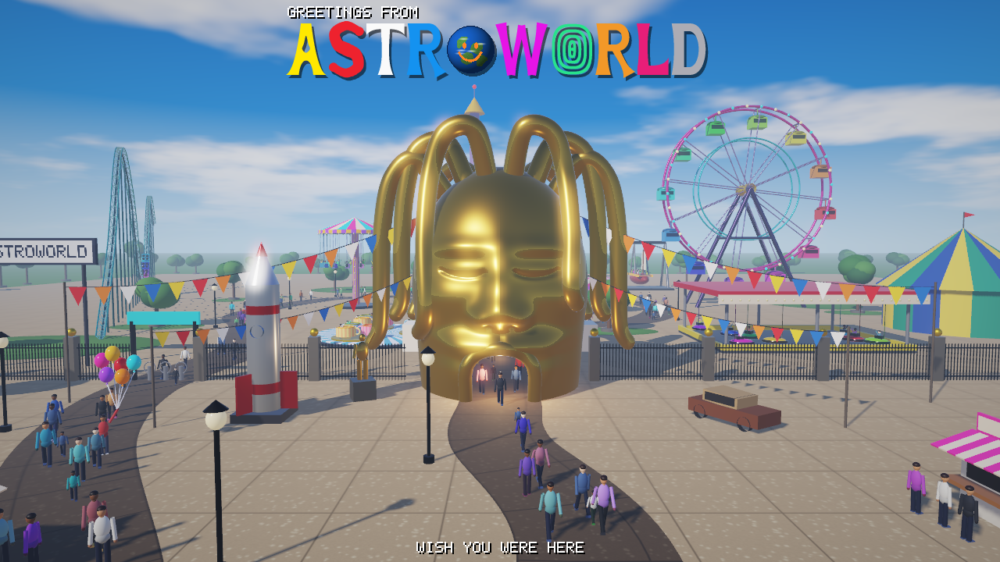 | 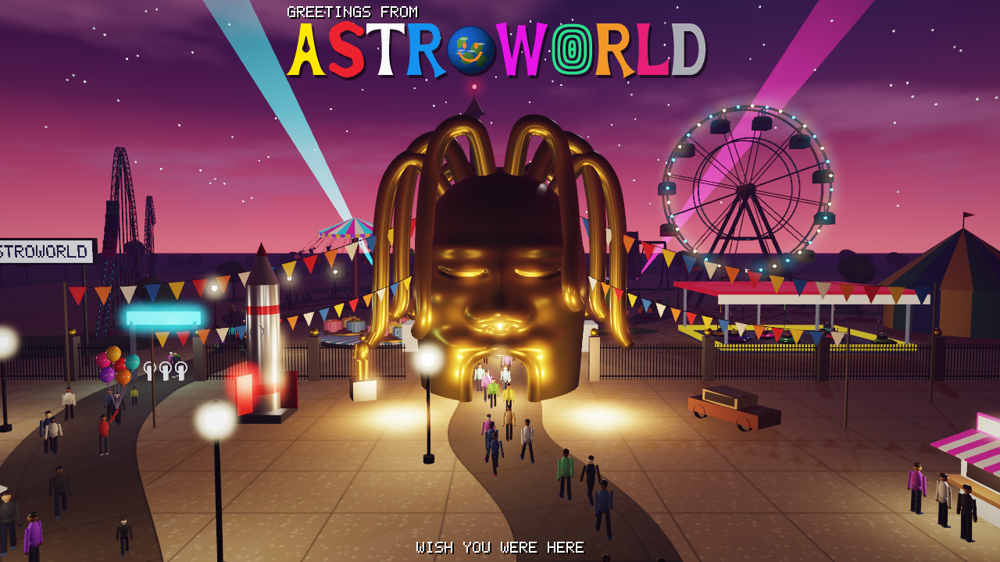 |
| 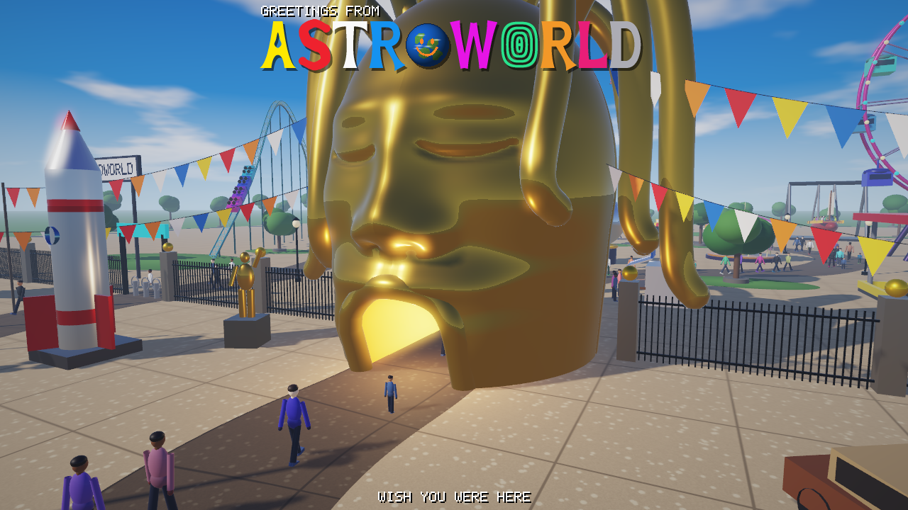 | 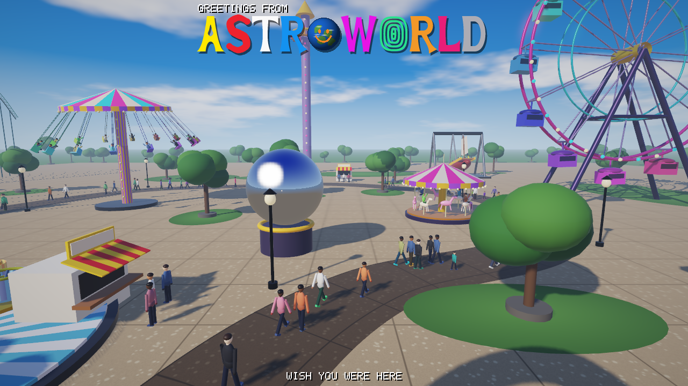 |

---

## Contents

1. [Project roadmap and branches](#project-roadmap-and-branches)
2. [Building and running](#building-and-running)
3. [Project structure](#project-structure)
4. [Course concepts → where they live in the code](#course-concepts--where-they-live-in-the-code)
5. [How the software renderer maps to the rendering pipeline](#how-the-software-renderer-maps-to-the-rendering-pipeline)
6. [Coding conventions](#coding-conventions)
7. [Checkpoint log](#checkpoint-log), ending with the [final report (Checkpoint 4)](#checkpoint-4--final-demonstration)

---

## Project roadmap and branches

Each checkpoint has its own branch, created from the previous one, so every stage can be checked out and run exactly as it was submitted.

| Branch | Stage | Focus |
|---|---|---|
| `checkpoint-1` | **CP1 – Technical foundation** | Course algorithms in pure C++, used to build simplified park components. Output: PPM images. |
| `checkpoint-1-window` | CP1 (windowed variant) | The same renderer shown live in a window through a basic windowing library. |
| `checkpoint-2` | **CP2 – Transformation & animation** | 2D/3D transforms with homogeneous matrices; rides animate; frames combined into a video. |
| `checkpoint-3` | **CP3 – OpenGL integration** | The park rebuilt in real-time 3D with OpenGL 3.3 core (GLFW + our own function loader): meshes, shaders, lighting, depth buffer, MSAA, orbit camera. |
| `prototype` | **Prototype** | Everything combined in one interactive app: a renderer-independent scene description, switchable flat/Gouraud/Phong shading, every projection type, mipmapped ground texture, searchlights, a coaster ride camera. |
| **`photorealism` ← you are here** | **Beyond the brief** | Photorealistic rendering (PBR, shadow mapping, HDR, bloom, tone mapping, instancing), an inflatable head with a walk-through mouth, and a much bigger park with more rides and ~140 visitors. |
| `final` | **Final project** | A CPU ray tracer (Whitted) and path tracer (global illumination) of the same 3D scene, a mirror-ball sculpture, shared textures, and the final report (Checkpoint 4). |

### Earlier stages, newest first

Every earlier stage has its own branch. Check one out (and rebuild) to run it exactly as it was.

#### 1. Final project – ray tracing and path tracing (Checkpoint 4)

*Branch `final` (graded).* A CPU Whitted ray tracer (hard shadows, mirror reflections) and a path tracer (global illumination) of the same 3D park, with a BVH and anti-aliasing, plus the final report.

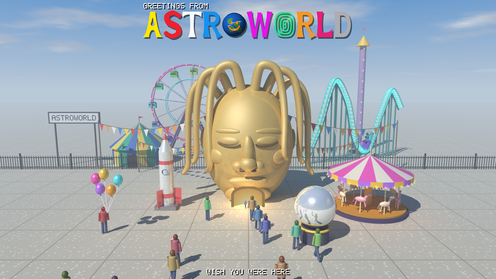

#### 2. Prototype – all components combined

*Branch `prototype` (graded).* Everything in one interactive OpenGL app: switchable flat, Gouraud and Phong shading, every projection type (1-, 2- and 3-point perspective, isometric, oblique, multiview), textures with mipmapping and a coaster ride camera.

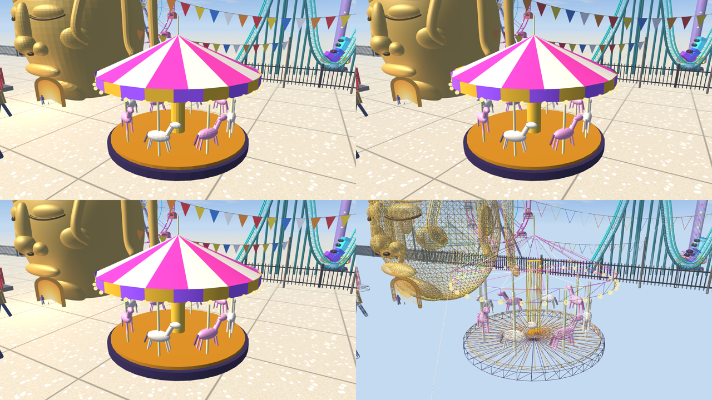

#### 3. Checkpoint 3 – OpenGL integration

*Branch `checkpoint-3` (graded).* The park rebuilt in real-time 3D with OpenGL 3.3 core: meshes, GLSL shaders, Phong lighting, a depth buffer, MSAA and an orbit camera, driven by our own matrices.

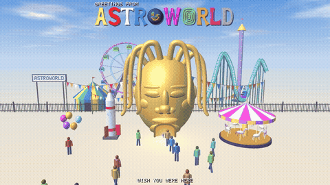

#### 4. Checkpoint 2 – Transformation and animation

*Branch `checkpoint-2` (graded).* Homogeneous 2D and 3D transformations bring the 2D park to life: turning rides, a physics-timed coaster, the crowd walking in and a day-to-night cycle, rendered as a video.

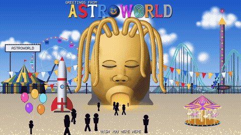

#### 5. Checkpoint 1, windowed variant

*Branch `checkpoint-1-window` (graded).* The Checkpoint 1 renderer shown live in a window through SDL2. SDL2 only displays the image; our code still draws every pixel.

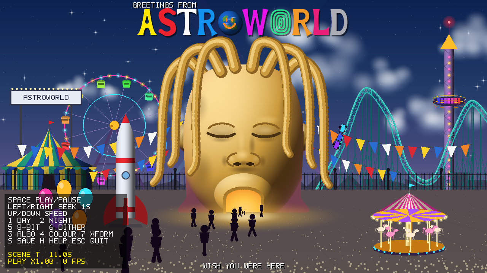

#### 6. Checkpoint 1 – Technical foundation

*Branch `checkpoint-1` (graded).* Every course algorithm written by hand in C++ (lines, circles, ellipses, clipping, curves, fills, colour models) and used to draw a still park, saved as PPM images.


---

## Building and running

**Requirements:** a C++17 compiler (g++ 9+ / clang 10+ / MSVC 2019+) and, optionally, CMake 3.16+. The software renderer uses **no external libraries**. Optional targets, which CMake skips when their library is missing:
- `astroworldWindow` (live player for the software renderer) needs **SDL2**: `sudo apt install libsdl2-dev`
- `astroworldGl` (CP3, OpenGL 3.3 core) needs **GLFW** and the Khronos GL headers: `sudo apt install libglfw3-dev` (the headers come with Mesa's dev packages)

The ray tracer `astroworldRay` needs no libraries beyond the C++ standard library (it uses `std::thread`).

`ffmpeg` is only used to encode videos and convert screenshots: every pixel is drawn by our own code.

### With CMake

```bash
cmake -S . -B build
cmake --build build
./build/astroworld          # write every still image as a PPM file
./build/astroworldWindow    # play the software-rendered animation live in a window
./build/astroworldGl        # CP3: the 3D park in OpenGL
./build/astroworldRay       # final: ray trace the 3D park (add --mode path for path tracing)
./tools/makeVideo.sh        # render the 30 s animation loop to output/astroworldAnimation.mp4
./tools/makeVideo.sh 30 30 opengl   # ...or the OpenGL version to output/astroworldAnimationGl.mp4
```

### Without CMake (single command)

```bash
# Software renderer only (the other programs need CMake's dependency detection):
g++ -std=c++17 -O2 -Wall -Wextra -Isrc src/main.cpp $(find src -name '*.cpp' ! -name '*Main.cpp' ! -name main.cpp \
    ! -path 'src/gl*' ! -path 'src/park3d/*' ! -path 'src/mesh/*' ! -path 'src/raytrace/*') -o build/astroworld
```

### OpenGL park (`astroworldGl`, Checkpoint 3 and prototype)

| Day | Night |
|---|---|
| 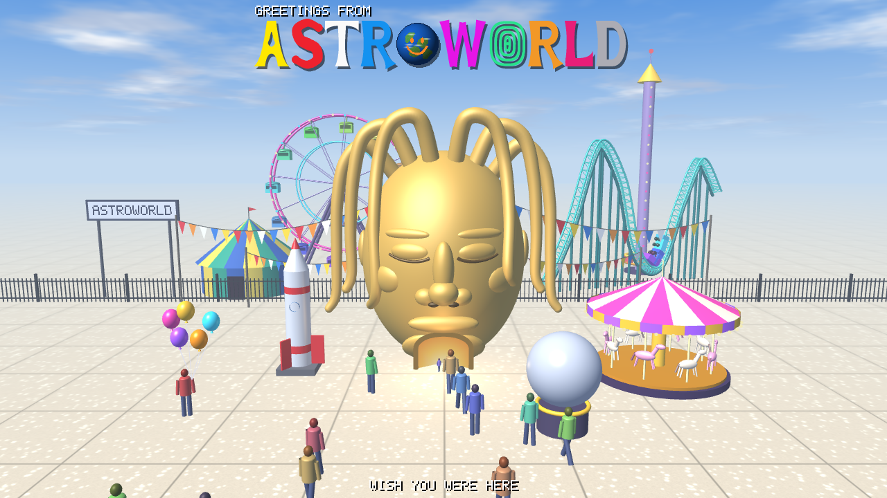 | 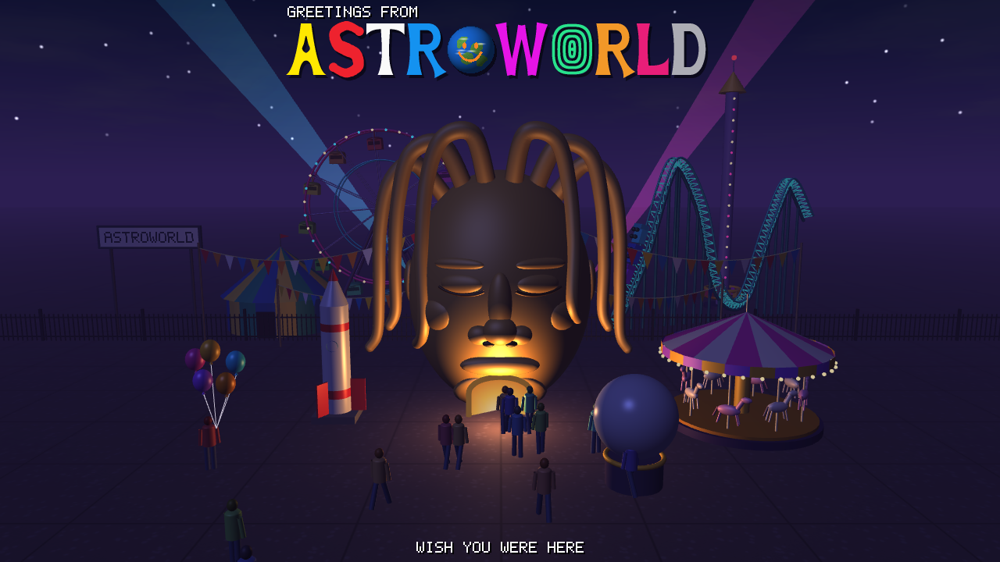 |
| 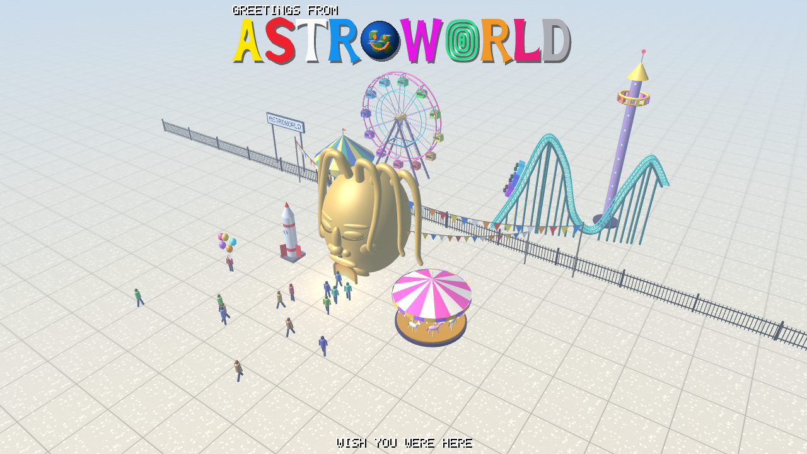 | 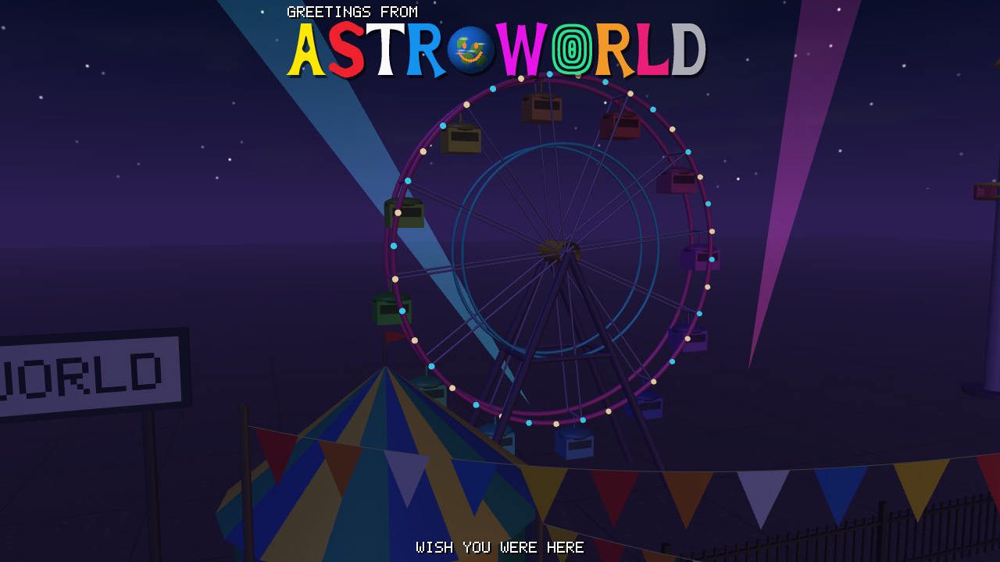 |

| Input | Action |
|---|---|
| Mouse drag / scroll | Orbit the camera / zoom |
| `W` `A` `S` `D` / `Q` `E` | Move the camera's target / up and down |
| `C` | Cycle viewpoints: album cover, aerial, Ferris wheel, carousel, one-, two- and three-point perspective |
| `R` | Ride the roller coaster (first-person camera on the front car) |
| `V` | Cycle projections: perspective, isometric, oblique cavalier, oblique cabinet, top view, front view |
| `G` / `F` | Cycle shading (flat, Gouraud, Phong) / toggle wireframe |
| `T` / `M` | Toggle texture mapping / mipmapping |
| `O` | Toggle automatic orbit |
| `Space`, `←` / `→`, `↑` / `↓` | Play / pause, seek ±1 s, speed ×2 / ÷2 |
| `1` / `2` | Jump to day / night |
| `L` / `H` | Toggle the logo overlay / help panel |
| `P` | Save a screenshot to `output/` |
| `Esc` | Quit |

Command-line options:
- `--camera <0-6>`, `--projection <0-5>` and `--shading <0-2>` pick the starting viewpoint, projection and shading.
- `--ride`, `--wireframe`, `--no-logo`, `--no-textures` and `--no-mipmaps` match the keys above, so every mode can be captured from scripts.
- `--time <s>` sets the starting time.
- `--capture <file.ppm>` renders one frame off-screen and exits.
- `--animate <seconds> <fps> <dir | ->` renders a frame sequence, exactly like the software renderer.
- `--duration <s>` closes the window after that many seconds and prints the average FPS.
- `--software` forces Mesa's CPU rasterizer instead of the GPU.

**GPU selection under WSL:** by default Mesa renders OpenGL on the CPU (`llvmpipe`). WSL's `d3d12` driver forwards OpenGL to the real GPU through `/dev/dxg`, so the program selects it automatically when that device exists (it sets `GALLIUM_DRIVER=d3d12` unless you have set it yourself).

### Ray tracer (`astroworldRay`, final)

| Whitted ray tracing, day | Whitted ray tracing, night |
|---|---|
| 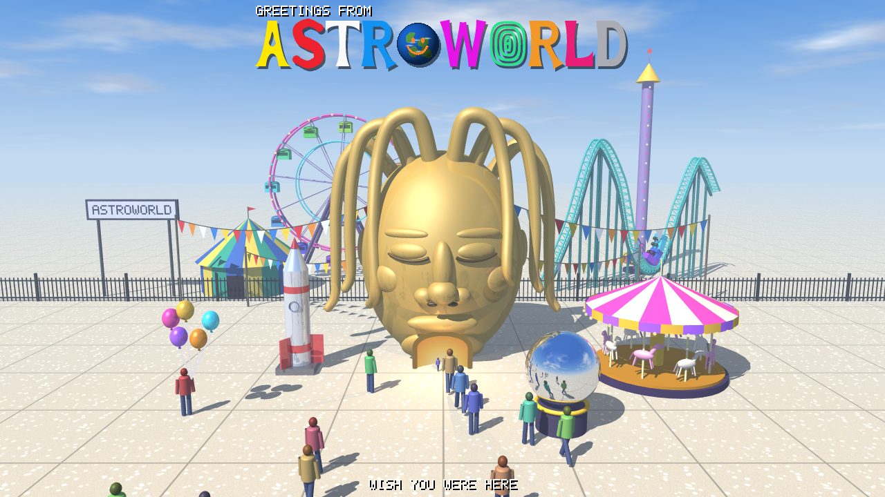 | 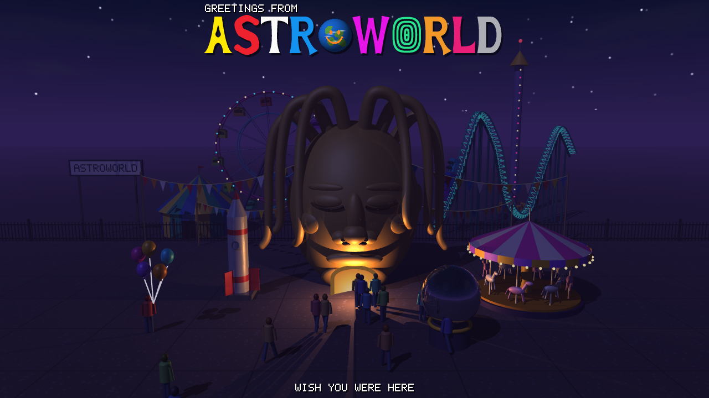 |
| **Path tracing (global illumination), day** | **Path tracing, night** |
|  | 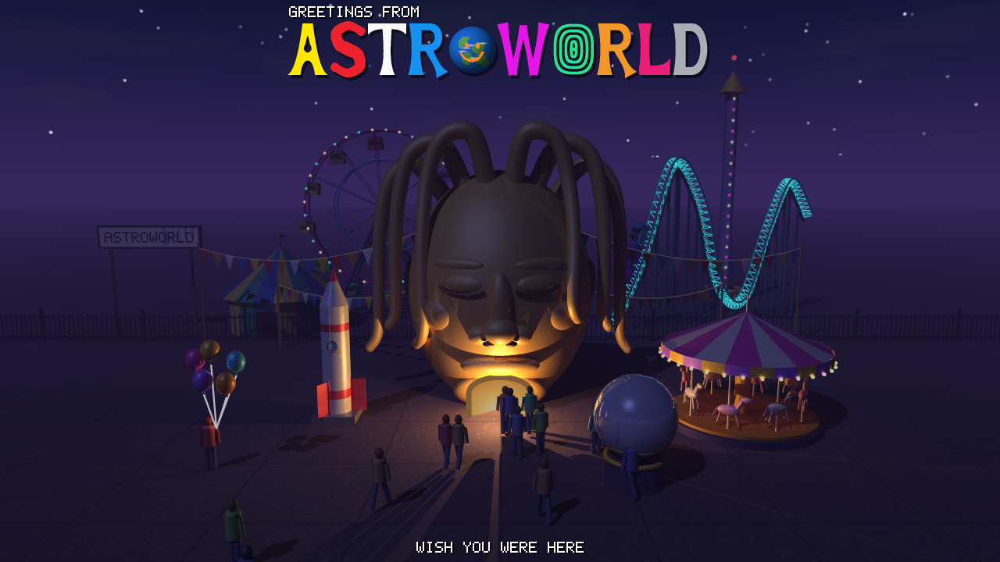 |

```bash
./build/astroworldRay                                  # Whitted, 9 samples/pixel, day   (~7 s)
./build/astroworldRay --time 18                        # ...at night
./build/astroworldRay --mode path --samples 128        # path traced with global illumination (~3 min)
./build/astroworldRay --camera 1 --projection 1        # any viewpoint and projection from the OpenGL viewer
```

Options:
- `--mode whitted|path`, `--samples n` (per pixel), `--depth n` (reflection depth / bounces)
- `--width`, `--height`, `--time`, `--camera`, `--projection`
- `--threads`, `--no-logo`, `--output file.ppm`

It prints triangle count, BVH build time, render time and rays per second. Measured on this machine (12 threads, 1280×720, 91,721 triangles, BVH built in 0.25–0.3 s):

| Image | Samples/pixel | Rays | Render time |
|---|---|---|---|
| Whitted, day | 16 | 37.9 M | 11.7 s |
| Whitted, night | 16 | 37.9 M | 10.9 s |
| Path traced, day | 128 | 411 M | 172 s |
| Path traced, night | 128 | 407 M | 157 s |

### Live window (software renderer)


`astroworldWindow` runs exactly the same pure C++ renderer and plays the animation in real time. SDL2 only handles the last pipeline stage, **display**: each finished `FrameBuffer` is uploaded to a streaming texture (`SDL_PIXELFORMAT_RGB24` has the same byte layout as our `Color`, so nothing is converted) and presented in a resizable, letterboxed window.

Every frame, the real elapsed time (times the playback speed) is added to the animation clock and the scene is rendered for that time. Because each frame is a pure function of time, the motion runs at the right speed at any frame rate, and seeking is instant. A frame takes about 50–70 ms on the CPU (roughly 15–20 fps). That limit is the reason CP3 moves rendering to the GPU.

| Key | Action |
|---|---|
| `Space` | Play / pause |
| `←` / `→` | Seek −1 s / +1 s |
| `↑` / `↓` | Playback speed ×2 / ÷2 (0.25× to 4×) |
| `1` / `2` | Jump to day (t = 0) / night (t = 18 s) |
| `5` / `6` | Scene reduced to 8-bit / 8-bit dithered (still animating) |
| `3` / `4` / `7` | Algorithm / colour / transformation showcase |
| `S` | Save the current image to `output/window_<view>.ppm` |
| `H` | Show / hide the help overlay (with live FPS) |
| `Esc` / `Q` | Quit |

Command-line options: `--time <seconds>` sets the starting animation time. `--capture <file.ppm>` renders one frame, reads it **back** from the renderer with `SDL_RenderReadPixels`, saves it and exits; add `--with-help` to keep the overlay. The capture at t = 0 matches `astroworld`'s PPM still byte for byte, which shows the window displays the frame buffer exactly.

### Animation and video

```bash
./build/astroworld --animate <seconds> <fps> <directory>   # frame_00000.ppm, frame_00001.ppm, ...
./build/astroworld --animate 30 30 - | ffmpeg ...          # stream frames on stdout (no files)
./tools/makeVideo.sh [seconds] [fps]                       # MP4 + README GIF preview
```

`makeVideo.sh` pipes the raw PPM frames straight into ffmpeg, so 900 frames (≈2.4 GB of raw pixels) are never written to disk. A full 30 s loop at 30 fps takes about a minute to render.

### Output

Running `./build/astroworld [outputDirectory]` (default `output/`) writes:

| File | What it shows |
|---|---|
| `astroworldDay.ppm` | The park as on the album cover (24-bit colour) |
| `astroworldNight.ppm` | The same park at night: starfield, searchlights, brighter portal |
| `astroworldDay8Bit.ppm` | Day scene reduced to 256 colours (3-3-2 RGB) |
| `astroworldDay8BitDither.ppm` | 256 colours with 4×4 ordered (Bayer) dithering |
| `algorithmShowcase.ppm` | Every CP1 algorithm shown on its own, labelled |
| `colorShowcase.ppm` | HSV, tints/shades/tones, RGB vs CMYK, colour depth, palette |
| `transformShowcase.ppm` | Every CP2 transformation shown on its own, labelled |

PPM files open in GIMP, most Linux image viewers, and VS Code with a PPM extension. To regenerate the PNGs in `docs/screenshots/`:

```bash
./tools/exportScreenshots.sh
```

---

## Project structure

```
src/
├── main.cpp                    Command-line renderer: stills, or animation frames (--animate)
├── windowMain.cpp              Live SDL2 player for the animation (display stage only)
├── glMain.cpp                  CP3: GLFW window + OpenGL context, interactive 3D park
├── rayMain.cpp                 Final: command-line ray tracer / path tracer
├── raytrace/
│   ├── rayGeometry.h/.cpp      World-space triangles from a ParkFrame, BVH, Moller-Trumbore intersection
│   └── rayTracer.h/.cpp        Whitted + path tracing, shadow rays, reflections, sky model, supersampling, threads
├── gl/
│   ├── glFunctions.h/.cpp      Our own OpenGL 3.3 core function loader (what GLAD does)
│   └── glResources.h/.cpp      RAII wrappers: shader programs, GPU meshes, textures, MSAA render target
├── mesh/
│   ├── meshData.h              Vertex format (position, normal, colour, UV), indexed meshes, transformed append
│   └── meshBuilder.h/.cpp      Box, cylinder, cone, ellipsoid, torus, swept tube, quads, lines
├── park3d/                     The 3D park, independent of any graphics API
│   ├── parkScene.h/.cpp        Scene description: instances (mesh + model matrix + material) and lighting at time t
│   ├── headModel.h/.cpp        The head in 3D: features wrapped onto an ellipsoid, dread tubes, portal
│   ├── parkModels.h/.cpp       3D rides, props, mirror ball and searchlight beams
│   ├── parkTextures.h/.cpp     Ground and sign textures (drawn by the software renderer) + bilinear sampling
│   └── orbitCamera.h           Orbit camera; perspective, isometric, oblique and multiview projections; presets
├── glScene/                    The OpenGL renderer
│   ├── shaders.h               GLSL: Phong model shared by flat/Gouraud/Phong shading, sky, beams, overlays
│   ├── astroworldPark.h/.cpp   Uploads the scene's meshes and textures; draws a ParkFrame
│   └── overlayImage.h/.cpp     Software-rendered images → RGBA textures (difference matting)
├── core/
│   ├── vec2.h                  2D vector maths, pi, rounding helper
│   ├── color.h/.cpp            RGB/HSV/CMYK conversions, tints/shades/tones, 8-bit reduction, palette
│   ├── frameBuffer.h/.cpp      Pixel memory, spans, alpha blending, dithering, PPM output
│   ├── coverageMask.h/.cpp     Off-screen stencil mask + supersampled (anti-aliased) compositing
│   └── simpleRandom.h          Deterministic xorshift random generator
├── math/
│   ├── matrix3.h/.cpp          2D homogeneous 3×3 matrices: translate, rotate, scale, shear, reflect, pivots
│   ├── vec3.h                  3D vectors (dot, cross)
│   └── matrix4.h/.cpp          3D homogeneous 4×4 matrices: rotations, orthographic and perspective projection
├── animation/
│   ├── easing.h                Easing curves (smoothstep, quad, cubic, bounce), looping time, oscillators
│   ├── keyframeTrack.h         Keyframe tracks with per-segment easing
│   └── astroworldTimeline.h/.cpp  Day/night, drop tower and coaster timing shared by BOTH renderers
├── raster/
│   ├── rasterTypes.h           Plot/span callbacks: rasterization kept separate from shading
│   ├── lines.h/.cpp            DDA and Bresenham lines
│   ├── circles.h/.cpp          Midpoint circle (8-way) and midpoint ellipse (4-way)
│   ├── clipping.h/.cpp         Cohen–Sutherland line clipping
│   └── strokes.h/.cpp          Thick and tapered strokes (scan-line quads + circle caps)
├── curves/
│   ├── bezier.h/.cpp           Cubic Bézier (Bernstein) and any-degree de Casteljau
│   └── spline.h/.cpp           Catmull–Rom splines (open and closed)
├── fill/
│   ├── scanLineFill.h/.cpp     Edge Table / Active Edge Table polygon fill (even-odd)
│   └── boundaryFill.h/.cpp     4- and 8-connected boundary fill (explicit stack)
├── text/
│   ├── bitmapFont.h/.cpp       5×7 raster font for labels
│   └── astroWordmark.h/.cpp    The ASTROWORLD logo: flared vector letters, globe O, ring O
├── scene/
│   ├── astroworldScene.h/.cpp  Composes the park at any time t; the animation timeline lives here
│   ├── backdrop.h/.cpp         Day/night sky, clouds, stars, searchlights, skyline, fence, plaza
│   ├── astroHead.h/.cpp        The brass head: dreads, closed eyes, nose, glowing mouth portal
│   ├── astroHeadShape.h        Head-unit shape data (dreads, doorway) shared by the 2D and 3D heads
│   ├── brassShading.h          Matte-brass surface shader (faux lighting)
│   ├── carnivalProps.h/.cpp    Rocket statue, big-top tent, park sign, bunting
│   ├── ferrisWheel.h/.cpp      Ferris wheel (transformation hierarchy)
│   ├── rollerCoaster.h/.cpp    Roller coaster track, physics-timed train
│   ├── dropTower.h/.cpp        Drop tower
│   ├── carousel.h/.cpp         Carousel (horses placed with 4×4 matrices)
│   └── foreground.h/.cpp       Crowd walking into the mouth, balloon vendor
└── showcase/
    ├── showcasePanel.h           Shared 4×2 labelled-panel layout
    ├── algorithmShowcase.h/.cpp  CP1 algorithm demos
    ├── colorShowcase.h/.cpp      Colour-theory demos
    └── transformShowcase.h/.cpp  CP2 transformation demos
tools/exportScreenshots.sh      PPM → PNG for documentation
tools/makeVideo.sh              Animation → MP4 (and README GIF) from either renderer, frames piped into ffmpeg
docs/screenshots/               Checkpoint screenshots
docs/references/                Reference artwork the scene is matched against (local only, not committed)
```

---

## Course concepts → where they live in the code

### Hardware and core fundamentals
| Concept | Implementation |
|---|---|
| **Raster vs. vector** | The bitmap font ([bitmapFont.cpp](src/text/bitmapFont.cpp)) is a *raster* font: it goes blocky when scaled (see the captions). The logo ([astroWordmark.cpp](src/text/astroWordmark.cpp)) is *vector*: its letters are described by curves and polygons, so it stays smooth at any size. |
| **Frame buffer** | [frameBuffer.h](src/core/frameBuffer.h): a row-major pixel array, the CPU-side equivalent of the VRAM frame buffer. "Display" means writing it to a PPM file, or, in the windowed build, uploading it to video memory as a texture (and reading it back with `--capture`). |
| **CPU vs. GPU** | Measured on this machine: the CP2 software renderer manages ~15–20 fps. The CP3 OpenGL renderer, a far heavier 3D scene, runs at **~83 fps on the GPU** (AMD Radeon via D3D12) but only **~14 fps** when the same OpenGL code runs on Mesa's CPU rasterizer (`--software`). The GPU processes thousands of vertices and fragments in parallel. |

### Colour theory and models
| Concept | Implementation |
|---|---|
| RGB / HSV / CMYK | `hsvToRgb`, `rgbToHsv`, `rgbToCmyk`, `cmykToRgb` in [color.cpp](src/core/color.cpp). Demonstrated in the colour showcase. |
| Hue, saturation, value; tints, shades, tones | `makeTint`, `makeShade`, `makeTone`. The Ferris wheel gondolas space their hues evenly around the HSV wheel. |
| Colour harmony | `astroPalette`, sampled from the album artwork: complementary blue sky against brass/gold for the day, navy against neon for the night, and a full-spectrum rainbow for the logo letters. |
| 24-bit → 8-bit reduction | `reduceTo8Bit` / `expandFrom8Bit` (3-3-2 RGB) plus Bayer dithering in `FrameBuffer::reducedTo8Bit`. |
| HSV interpolation | `lerpColorHsv`: the sky gradient goes the short way round the hue circle; `nightAmount` blends the day and night palettes. |

### Geometric primitives and drawing algorithms
| Algorithm | Where it is used in the park |
|---|---|
| **DDA line** ([lines.cpp](src/raster/lines.cpp)) | Searchlight rays, concrete joints in the plaza; the clipping demo |
| **Bresenham line** (integer decision parameter) | Ferris wheel spokes, the coaster's lattice truss, fence pickets and rails, star flares, bunting strings |
| **Midpoint circle** (8-way symmetry) ([circles.cpp](src/raster/circles.cpp)) | Ferris wheel rims and hub, light bulbs, the globe, round stroke caps |
| **Midpoint ellipse** (4-way symmetry, two regions) | Carousel, balloons, ears, lips, clouds, glows and soft shadows |
| **Line clipping** (Cohen–Sutherland) ([clipping.cpp](src/raster/clipping.cpp)) | Searchlight rays are 2200 px long and are clipped to the screen; plaza joints are clipped to the ground |

### Curves
| Concept | Where it is used |
|---|---|
| Parametric curves | Every curve is evaluated as a function of `t ∈ [0, 1]` |
| **Bézier curves** ([bezier.cpp](src/curves/bezier.cpp)) | Eyelids, nose creases, the mouth arch, the bowls of R and D, the A's outline, the rocket's nose and fins, the tent roof, sagging bunting, balloon strings |
| **Splines** (Catmull–Rom, [spline.cpp](src/curves/spline.cpp)) | Coaster track, head silhouette, the dreads, the S's spine, teardrop counters, the continents on the globe |

### Polygons and area filling
| Concept | Where it is used |
|---|---|
| **Scan-line fill** (ET + AET, even-odd) ([scanLineFill.cpp](src/fill/scanLineFill.cpp)) | Sky, ground, head, logo letters, skyline (highly concave), tent, rocket, pennants, gondolas, cars |
| **Boundary fill** (4- vs 8-connected) ([boundaryFill.cpp](src/fill/boundaryFill.cpp)) | Balloons. The showcase shows why 8-connected fill leaks through diagonal Bresenham outlines |
| Convex / concave / complex polygons | The showcase fills a concave star and a self-intersecting pentagram (hollow centre under the even-odd rule) |

### 2D and 3D transformations (CP2)
| Concept | Where it is used |
|---|---|
| **Homogeneous coordinates** | [matrix3.h](src/math/matrix3.h): 2D points are `(x, y, 1)` and directions `(x, y, 0)`, so translation is a matrix product like everything else. [matrix4.h](src/math/matrix4.h) does the same in 3D with `(x, y, z, 1)`. |
| **Translation** | Clouds drift (with parallax and wrap-around); visitors walk to the mouth; every model matrix starts with `T(position)` |
| **Rotation** | The Ferris wheel turns about its hub; coaster cars are rotated to the track's slope; pennants flutter |
| **Rotation about a pivot** `T(p)·R·T(−p)` | Dreads bend about their roots; balloons sway about the vendor's hand; walking legs swing about the hip |
| **Scaling about a fixed point** `T(p)·S·T(−p)` | The inflatable head "breathes" about its base so the mouth stays on the ground; visitors shrink to nothing as they step into the light |
| **Composite transforms / order** | `model = S_about(base) · T(center) · S(scale)` for the head; the showcase shows `T·R ≠ R·T` |
| **Hierarchical transforms** | Ferris wheel: `wheel = T(hub)·R(θ)`, `spoke_i = wheel·R(i·30°)`, and gondolas take only the spoke's position so they hang level |
| **4×4 matrices in 3D** | Carousel horses: `Rx(tilt) · Ry(θ + i·45°)` places each horse in 3D; depth (z) sorts them back to front |
| **Shear, reflection** | Transformation showcase (panel 4) |

### Projections
| Concept | Where it is used |
|---|---|
| **Orthographic: multiview** | `V` → top view (true plan) and front view (true elevation): parallel projectors perpendicular to the view plane |
| **Orthographic: axonometric / isometric** | `V` → isometric: the camera looks down the cube diagonal (elevation atan(1/√2) ≈ 35.26°, 45° around), so the x, y and z axes are equally foreshortened |
| **Oblique: cavalier, cabinet** | `V` → `Matrix4::obliqueShear` shears depth onto a 45° diagonal before an orthographic projection: full depth (cavalier) or half depth (cabinet) |
| **Perspective, centre of projection, frustum** | Default mode: `Matrix4::perspective` with the eye as the centre of projection; the GPU clips to the view frustum and divides by *w* |
| **One-, two- and three-point perspective** | `C` presets: a level camera square to the fence (one vanishing point: only depth lines converge); turned 45° (two: both ground axes converge); tilted up at the drop tower (three: verticals converge too) |
| CP2 parallel uses | Carousel horses (z dropped after the view rotation); the showcase cube uses `Matrix4::orthographic` |
| Camera / view transform | `Matrix4::lookAt` builds the view matrix from the orbit camera's eye (spherical coordinates around a target) |
| Viewport transform | NDC `[−1, 1]` → pixels: `glViewport` in OpenGL; done by hand in the transformation showcase |

### OpenGL (CP3)
| Concept | Implementation |
|---|---|
| Programmable pipeline | [shaders.h](src/glScene/shaders.h): the vertex shader applies `projection · view · model`; the fragment shader lights each sample |
| Function loading | [glFunctions.h](src/gl/glFunctions.h): every GL ≥ 1.2 function is looked up in the driver at runtime, as GLAD does |
| Vertex buffers | [glResources.cpp](src/gl/glResources.cpp): meshes go into VBOs/EBOs, described by a VAO (position, normal, colour, UV attributes) |
| Hidden-surface removal | The **depth buffer** (z-buffer) replaces CP1/CP2's painter's algorithm |
| **Lighting (Phong model)** | Blinn-Phong per fragment: ambient + diffuse + specular from the sun or moon, plus an attenuated **point light** in the mouth that lights the face and crowd at night |
| **Shading interpolation: flat / Gouraud / Phong** | `G` switches live. **Flat**: one normal per triangle from the screen-space derivatives of the position (`cross(dFdx, dFdy)`), so facets show. **Gouraud**: the Phong model is evaluated per *vertex* in the vertex shader and the colours are interpolated, so highlights smear and can be missed. **Phong**: the *normal* is interpolated and lighting runs per pixel. All three share one GLSL lighting function. `F` shows the wireframe. |
| Normal transformation | Normals use the inverse-transpose of the model matrix (in the shader, and in `MeshData::append`), so ellipsoid features stay correctly lit |
| **Texture mapping** | The plaza uses a 4 m concrete slab with joints and popcorn, drawn by the software renderer and **tiled** 100× with `GL_REPEAT`. The park sign's lettering is a UV-mapped texture; the logo and captions are textured screen-space quads. `T` toggles texturing. |
| **Mipmapping** | The ground texture has a full mip chain (`glGenerateMipmap`) with trilinear filtering. `M` switches to point sampling to show the shimmering aliasing on distant slabs that mipmaps remove. |
| Transparency | Searchlight beams use **additive blending** with depth writes off, fading along their length |
| **Anti-aliasing (MSAA)** | The scene renders into an off-screen 4× multisampled frame buffer object, resolved and then shown or read back |
| Procedural sky | A full-screen triangle reconstructs each pixel's view ray with the inverse view-projection matrix, then adds a gradient, value-noise clouds and twinkling stars |
| Fog | Exponential distance fog toward the horizon colour (aerial perspective) |
| Frame buffer read-back | `glReadPixels` turns GPU frames back into our `FrameBuffer` for screenshots and video |

### Scene description (prototype)
| Concept | Implementation |
|---|---|
| Scene graph / instancing | [parkScene.h](src/park3d/parkScene.h): the park at time *t* is a list of instances (mesh + model matrix + material) plus lighting. The OpenGL renderer draws that list; the final-phase ray tracer traces the same list. One mesh (a gondola, a horse, a visitor) is drawn many times with different matrices and tints. |
| Camera paths | The coaster ride camera follows the spline: eye at the front car, looking a few metres ahead along the track, banked with the car's up vector |

### Reusing earlier work in CP3
| From | Used in the OpenGL renderer for |
|---|---|
| `Matrix4` (CP2) | Every model, view and projection matrix, uploaded column-major. GLM is not needed. |
| Catmull–Rom splines (CP1) | 3D coaster track and the dreads (`sampleCatmullRomSpline3D`) |
| Bézier curves (CP1) | Closed-eye lash lines, the doorway arch, bunting sag |
| `astroworldTimeline` (CP2) | The same day/night keyframes, drop-tower keyframes and coaster physics, so both renderers stay in sync |
| `astroHeadShape` (CP1/CP2) | The same dread centre lines and doorway outline, wrapped onto an ellipsoid |
| Software renderer (CP1) | Draws the logo, captions, sign lettering and help panel; **difference matting** turns them into RGBA textures |
| Palette and colour maths (CP1) | Vertex colours, day/night lerps, HSV-spaced gondola and car colours |

### Animation (CP2)
| Concept | Where it is used |
|---|---|
| Time-based animation | Every frame is a pure function of `timeSeconds`, so playback is frame-rate independent and any frame can be rendered alone |
| **Keyframes + easing** ([keyframeTrack.h](src/animation/keyframeTrack.h), [easing.h](src/animation/easing.h)) | Drop tower: ease-in-out climb, pause, then a drop that accelerates and bounces (`easeOutBounce`). Day → dusk → night → dawn: smoothstep keyframes over a 30 s loop |
| Physically based motion | Coaster: constant-speed chain lift, then speed from energy conservation `v = √(v₀² + 2g·Δh)`, integrated along the spline by arc length |
| Procedural motion | Sine oscillators for swinging gondolas, bobbing horses, breathing head, swaying dreads, balloons and bunting, twinkling stars and sweeping searchlights |
| Walk cycle | Visitors' legs swing about the hip in opposite phase, with a bounce on each step |

### Ray tracing, path tracing and anti-aliasing (final)
| Concept | Implementation |
|---|---|
| **Ray casting** | [rayTracer.cpp](src/raytrace/rayTracer.cpp): each pixel is *unprojected* through the inverse view-projection matrix to get its ray, so every projection works (parallel rays for orthographic views) |
| Ray-triangle intersection | Möller–Trumbore: solve origin + t·d = P₀ + u·E₁ + v·E₂ with Cramer's rule; the barycentric (u, v) interpolate normals, colours and texture coordinates |
| Acceleration structure | [rayGeometry.cpp](src/raytrace/rayGeometry.cpp): a **BVH** (bounding volume hierarchy) with median splits; slab tests let a ray skip whole subtrees, so ~92 000 triangles cost only a handful of tests per ray |
| **Whitted ray tracing** | Shadow rays to the sun and the portal light give hard shadows; recursive mirror rays reflect the park in the chrome ball, the rocket, the coaster and (subtly) the brass head |
| **Path tracing / global illumination** | Monte-Carlo solution of the rendering equation: cosine-weighted diffuse bounces, mirror bounces chosen with probability = reflectivity, next-event estimation (explicit shadow rays) for the sun and portal, emissive bulbs and doorway as area lights, sky light from bounced rays, and Russian roulette to end paths without bias |
| **Anti-aliasing (supersampling)** | Each pixel averages several **stratified, jittered** samples (a grid with one random point per cell), smoothing edges and texture detail |
| Tone mapping | Path-traced radiance above 1.0 is compressed with extended Reinhard instead of being clipped |
| Parallelism on the CPU | Rows are handed out to all hardware threads through an atomic counter (dynamic load balancing) |
| Same scene as OpenGL | The tracer flattens the same `ParkFrame` instances; line meshes become thin tubes, and the sky shader is ported to C++ |

### Rendering techniques
| Concept | Implementation |
|---|---|
| Painter's algorithm | Scene drawn far to near; carousel horses and crowd members are sorted by depth; outer dreads go behind the head, front dreads in front |
| Fragment shading | `PixelShader` callbacks colour each covered pixel (sky gradients, tent and canopy stripes, brass lighting, the portal glow) |
| Fragment discard | Rows below the ground line are discarded when filling the head and lips; continents are discarded outside the globe |
| Alpha blending | `FrameBuffer::blendPixel` and `blendSoftEllipse` (alpha falls off per pixel): clouds, glows, beams, sculpted shadows |
| Stencil mask | [coverageMask.h](src/core/coverageMask.h): letter pieces are *added* and counters *erased* off-screen, then composited |
| **Anti-aliasing** (SSAA) | The logo masks are rendered at 3×3 sub-samples per pixel and box-filtered down, so letter edges are smooth |
| Lighting (preview) | [brassShading.h](src/scene/brassShading.h) rebuilds an ellipsoid normal per pixel and applies diffuse, specular and rim terms. The dreads fake a lit cylinder with three offset tapered strokes. This is a preview of the full Phong model planned for the final phase. |

---

## How the software renderer maps to the rendering pipeline

| Pipeline stage | Software renderer (CP1 + CP2) |
|---|---|
| 1. Application | `renderAstroworldScene` decides what to draw and in what order |
| 2. Vertex processing | Model matrices (`Matrix3`) move every shape's local points into screen space. Carousel horses go through model → view → parallel projection with `Matrix4`. |
| 3. Primitive assembly | Points become polylines, polygons and ellipses |
| 4. Clipping | Cohen–Sutherland for lines; span clipping and bounds checks in `FrameBuffer` |
| 5. Rasterization | DDA, Bresenham, midpoint circle/ellipse and scan-line fill emit pixels or spans through `PlotCallback` / `SpanCallback` |
| 6. Fragment processing | `PixelShader` functions choose each pixel's colour |
| 7. Output operations | Overwrite, alpha-blend, or stencil-mask into the buffer (SSAA compositing of the logo) |
| 8. Frame buffer | `FrameBuffer` |
| 9. Display | `savePpm` writes the image file, `--animate` streams frames to ffmpeg, and the window uploads each frame to an SDL2 texture |

The same nine stages in the **OpenGL renderer (CP3)**:

| Pipeline stage | OpenGL renderer (CP3) |
|---|---|
| 1. Application | `AstroworldPark::render` animates the rides and issues draw calls (C++, CPU) |
| 2. Vertex processing | The vertex shader computes `projection · view · model · position` and transforms normals |
| 3. Primitive assembly | The GPU groups indices into triangles (`GL_TRIANGLES`) or lines (`GL_LINES`) |
| 4. Clipping | Fixed-function clipping against the view frustum, then the perspective divide |
| 5. Rasterization | Fixed-function, with 4 coverage samples per pixel (MSAA) |
| 6. Fragment processing | The fragment shader runs Blinn-Phong, point-light, texture and fog maths |
| 7. Output operations | Depth test, alpha blending for overlays, multisample resolve |
| 8. Frame buffer | Our off-screen FBO (`RenderTarget`): multisampled colour + depth renderbuffers |
| 9. Display | Blit to the window's default framebuffer with letterboxing, then `glfwSwapBuffers` |

---

## Coding conventions

- **camelCase** for variables, functions, members and file names (`fillPolygonScanLine`, `astroHead.cpp`). Types use UpperCamelCase (`FrameBuffer`, `RollerCoaster`).
- **Descriptive names**, no single letters, except where the maths itself uses them (`t` for curve parameters, `x`/`y`/`u`/`v` for coordinates).
- **Comprehensive inline documentation**: every file starts with a header comment, every public function has a doc comment, and each algorithm explains its maths (decision parameters, symmetry, edge tables) where the code runs it.
- Screen space: origin at the top-left, x to the right, **y down**.
- Deterministic output: all randomness uses a seeded `SimpleRandom`, so the same frame is drawn every time. Animated parts draw their per-object random values in the same order every frame, so nothing flickers.
- Model space vs. screen space: shapes are defined once in their own local coordinates and placed with a model matrix.

---

## Checkpoint log

### Checkpoint 1 – Technical foundation (pure C++)

**What are we building?**
An animated ASTROWORLD theme park that recreates the album world. The giant brass head (eyes closed, dreads arching over the crown) is both the centrepiece and the entrance: its open mouth on the ground glows, and visitors walk in. Around it are a Ferris wheel, a teal lattice roller coaster, a drop tower, a carousel, a rocket statue, a striped big top, bunting and a black palisade fence. The scene has a day mood (the cover) and a night mood (the starfield artwork), with the "Greetings from ASTROWORLD / Wish you were here" postcard logo above.

**What graphics concepts are used?**
Frame buffer and raster vs. vector graphics, RGB/HSV/CMYK colour models, tints/shades/tones, 24 → 8-bit colour reduction, DDA, Bresenham, midpoint circle and ellipse, Cohen–Sutherland clipping, Bézier curves, Catmull–Rom splines, scan-line and boundary fill, painter's-algorithm layering, stencil masking and supersampling anti-aliasing. Details are in the [table above](#course-concepts--where-they-live-in-the-code).

**What has been completed?**
- A software rasterizer written from scratch: every algorithm above, with no graphics libraries
- Each park component as a self-contained, parameterised struct: `FerrisWheel`, `RollerCoaster`, `DropTower`, `Carousel`, `AstroHead`, plus props, backdrop and foreground
- The ASTROWORLD logo matched to the reference artwork: flared waisted letters with teardrop counters, the Earth-smiley O, the concentric-ring O, and flat per-letter colours, drawn with anti-aliasing
- Day and night renders controlled by one `nightAmount` value
- An algorithm showcase and a colour showcase for the checkpoint demo
- 24-bit, 8-bit and dithered 8-bit renders of the day scene

| Algorithm showcase | Colour showcase |
|---|---|
| 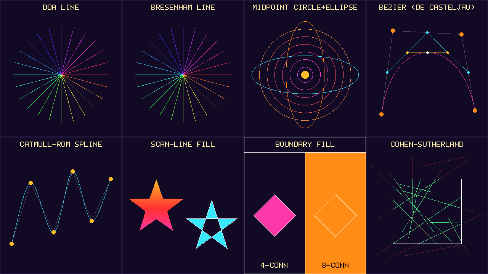 | 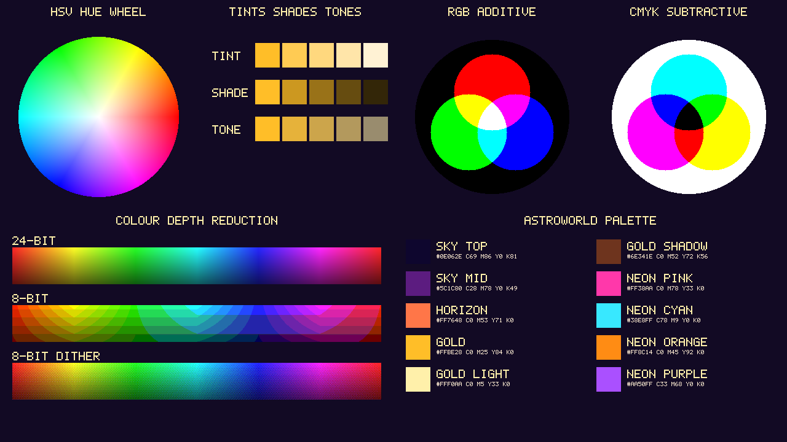 |

| 8-bit (3-3-2) | 8-bit dithered |
|---|---|
| 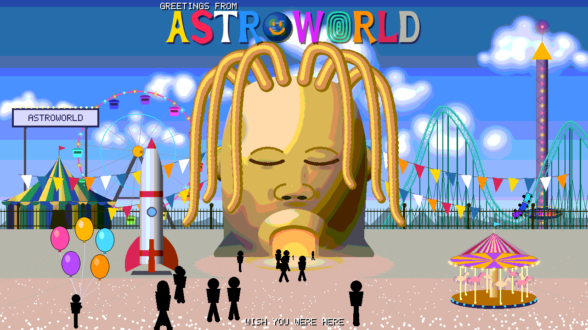 | 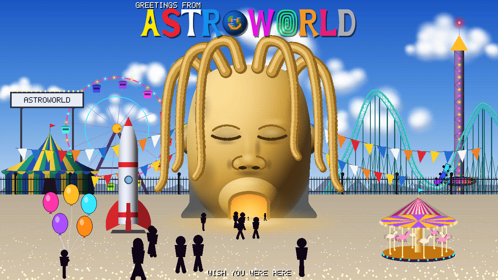 |

**What are we doing next? (CP2)**
- A `Matrix3` / `Matrix4` class for homogeneous-coordinate translation, rotation and scaling
- Rotate the Ferris wheel and carousel, drop the tower seats, run the coaster train along the spline by arc length, bob the horses, sway the dreads and bunting, walk the crowd into the mouth, sweep the searchlights, and run a day → night cycle with `nightAmount`
- Render a numbered frame sequence and combine it into an MP4 with `ffmpeg`
- The components already expose `rotationAngle`, `seatY`, `trainDistance` and `nightAmount`, so CP2 only has to drive them over time

### Checkpoint 2 – Transformation and animation (pure C++)

**What has been implemented?**
- **Matrix library:** `Matrix3` (2D homogeneous: translate, rotate, scale, shear, reflect, rotate/scale about a pivot, composition) and `Matrix4` (3D homogeneous: axis rotations, orthographic and perspective projection with the divide by *w*), with `Vec3`.
- **Every moving part is now drawn through transforms:**
  - Ferris wheel as a transformation hierarchy, with level, swinging gondolas
  - Coaster cars rotated onto the track's slope
  - Carousel horses positioned in 3D with 4×4 matrices and depth-sorted
  - The head's model matrix, which breathes by scaling about its base point
  - Dreads that bend about their roots
  - Pennants, balloons and walking legs rotating about pivots
- **An animation system:** a time-based clock, easing functions and keyframe tracks.
- **The animated park:**
  - a 30 s loop: day → dusk → night → dawn
  - Ferris wheel and carousel turning; a physics-driven coaster
  - drop-tower ride cycle (climb, suspense, bouncing drop)
  - a breathing head with swaying dreads and a pulsing glow
  - visitors walking into the mouth
  - drifting clouds, twinkling stars, sweeping searchlights, fluttering bunting
- **Output:**
  - real-time playback in the SDL2 window (play/pause, seek, speed)
  - frame export with `--animate`
  - MP4 encoding with frames streamed straight into ffmpeg
- **Performance:** per-row colour caching for the sky and ground, plus an inline `lerpColor`. Frame time dropped from ~100 ms to ~60 ms.

**Animation evidence**
- The GIF at the top of this README: the first 12 s of the loop.
- The full 30 s video: run `./tools/makeVideo.sh` to produce `output/astroworldAnimation.mp4`. It isn't committed (≈14 MB).

| Transformation showcase | Live window |
|---|---|
| 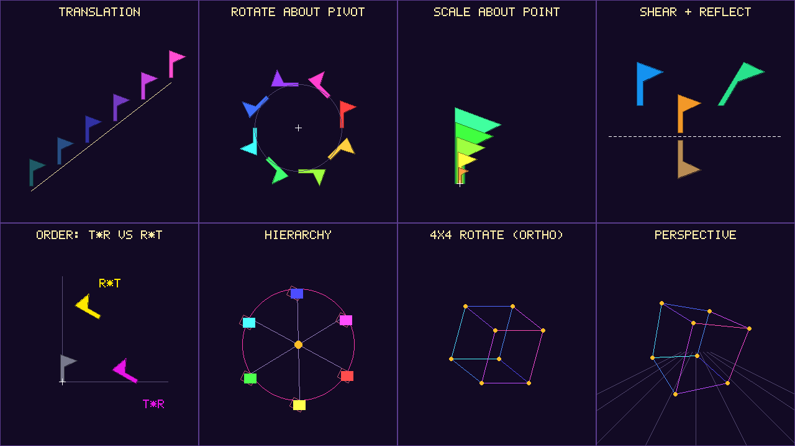 |  |

**What remains? (CP3 and beyond)**
- Port the components to **OpenGL** (GLFW + GLAD): the same `Matrix4` model/view/projection chain in a vertex shader, with the fragment work running in parallel on the GPU.
- Move from flat 2D layers to a **3D park**: a perspective camera that can fly through, real depth testing (z-buffer) instead of the painter's algorithm, and frustum clipping.
- Phong lighting on real meshes (the brass head, rides), Gouraud vs Phong shading, textures (the globe, the ground), MSAA, and a ray-traced still.
- User interaction: camera controls and toggles for rides and time of day.

### Checkpoint 3 – OpenGL integration

**Current OpenGL implementation**
- **Platform layer:** GLFW opens the window and an **OpenGL 3.3 core** context, and our own loader fetches the GL functions. A GLAD generator was not available offline, and writing the loader shows what such libraries actually do.
- **GPU resources:**
  - shader programs, plus vertex/index buffers described by VAOs
  - textures
  - a 4× MSAA off-screen frame buffer with depth
  - all wrapped in small RAII classes, so nothing leaks
- **The park in 3D, built procedurally from primitives (no model files):**
  - the brass head (features on an ellipsoid, swept-tube dreads, glowing doorway)
  - the Ferris wheel with level-hanging gondolas
  - the teal truss coaster
  - the drop tower and the carousel
  - the rocket, the big top and the textured park sign
  - bunting, the palisade fence, visitors and balloons
- **Lighting:** Blinn-Phong sun or moon, an attenuated point light inside the mouth, emissive bulbs and portal, and distance fog. The sky is procedural: a gradient, noise clouds and twinkling stars.
- **Animation:** the same animation as CP2, driven by the shared timeline. Rides move through `Matrix4` transformation hierarchies, the dreads are re-meshed each frame as they bend, visitors walk with swinging legs, and the 30 s day → night → dawn loop plays.

**Animation / interaction evidence**
- The GIF at the top of this README: the OpenGL renderer, first 12 s.
- The full 30 s OpenGL video: `./tools/makeVideo.sh 30 30 opengl` produces `output/astroworldAnimationGl.mp4` (≈7 MB, not committed).
- Interaction: an orbit, zoom and pan camera; four viewpoints; play, pause, seek and speed; toggles for the logo and help.
- Performance: ~83 fps on the GPU against ~14 fps for the same code on the CPU (`astroworldGl --duration 6` prints the average).

| Carousel close-up | Aerial view |
|---|---|
| 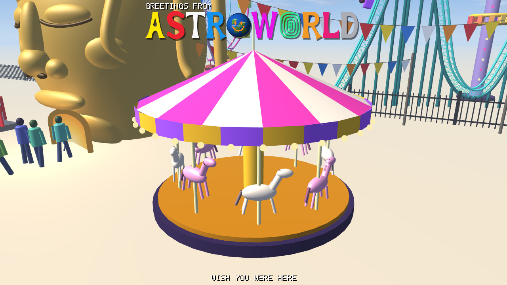 |  |

**GitHub link:** https://github.com/Karanei-Kimutai/ASTROWORLD/tree/checkpoint-3

**What remains (prototype and final)**
- **Shading comparison:** switchable flat, Gouraud and Phong shading to show the difference (the course's shading-interpolation topic).
- **More texture mapping:** the Earth texture on a 3D globe, ground detail (concrete joints and popcorn), the tent canvas.
- **Shadows** from the sun (shadow mapping) and night searchlight beams.
- **Head refinement:** a sculpted mesh instead of ellipsoid features for the nose and lips, and a real opening in the mouth.
- **Ray-traced still:** chrome spheres and the brass head reflecting the park, rendered on the CPU (ray tracing and anti-aliasing topics).
- **Polish and interaction:** ride on the coaster (first-person camera along the spline), click a ride to toggle it, and sound.

### Prototype – all components combined

**What the prototype adds**
- **One scene, any renderer.** `ParkScene` describes the park at time *t* as instances plus lighting. It contains no graphics-API code, so the OpenGL renderer and the coming ray tracer draw the same park.
- **Shading interpolation, live:** flat, Gouraud and Phong share one lighting function. A wireframe view shows the tessellation.
- **Every projection in the syllabus:**
  - perspective, isometric (axonometric)
  - oblique cavalier and cabinet
  - top and front multiview
  - viewpoints set up for one-, two- and three-point perspective
- **Texture mapping with mipmaps:** a tiled concrete-and-popcorn plaza drawn by the CP1 software renderer.
- **Night atmosphere:** sweeping additive searchlight beams.
- **Coaster ride:** first-person camera from the front car, using the physics-timed train position.

| Flat · Gouraud / Phong · wireframe | Coaster ride |
|---|---|
|  | 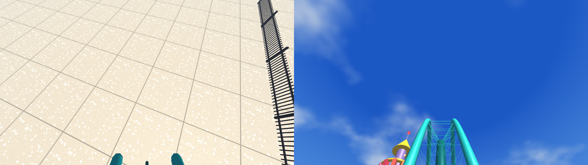 |

Projections, left to right and top to bottom: isometric, cavalier, cabinet, top view, front view, and perspective at night with searchlights:

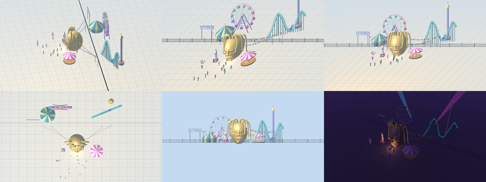

One-, two- and three-point perspective:

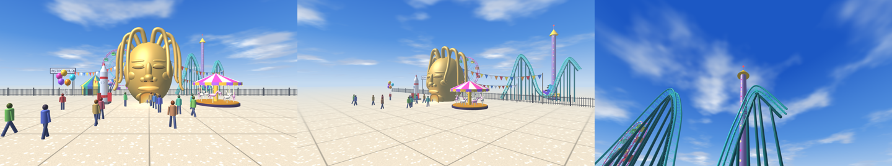

### Checkpoint 4 – Final demonstration

#### Final demonstration (suggested 5-minute walkthrough)
1. **Software renderer (CP1/CP2):** `./build/astroworldWindow`. Press `3` (algorithm showcase), `4` (colour), `7` (transformations), then `1`/`2` and let the day → night animation play. Mention that every pixel comes from our own DDA, Bresenham, midpoint, scan-line and boundary-fill code.
2. **OpenGL park (CP3/prototype):** `./build/astroworldGl`.
   - Drag to orbit; press `C` for the viewpoints, including one-, two- and three-point perspective.
   - Press `V` through the projections: isometric, cavalier, cabinet, top, front.
   - Press `G` for flat, Gouraud and Phong shading, and `F` for the wireframe.
   - Press `T`/`M` for texturing and mipmaps (look at the far plaza).
   - Press `R` to ride the coaster, and `2` to jump to night with the searchlights.
3. **Ray tracer (final):** show the pre-rendered Whitted and path-traced stills (above). Point out the hard shadows, the reflections in the mirror ball, and the soft global illumination. Run `./build/astroworldRay --width 640 --height 360` live: it takes a few seconds and prints its BVH and rays-per-second statistics.
4. **CPU vs GPU:**
   - CP2 software renderer: ~15–20 fps.
   - OpenGL on the GPU: ~75–85 fps.
   - The same OpenGL on Mesa's CPU rasterizer: ~14 fps.
   - The ray tracer: seconds to minutes per frame, because every pixel traces many rays.

#### What works
- **All course topics are implemented and visible.** The [concept tables](#course-concepts--where-they-live-in-the-code) map each one to its code:
  - raster vs vector, frame buffers, colour models, 8-bit reduction
  - DDA, Bresenham, midpoint circle and ellipse, line clipping
  - Bézier curves and splines
  - scan-line and boundary fill
  - 2D/3D homogeneous transforms
  - every parallel and perspective projection
  - the Phong model with flat, Gouraud and Phong shading
  - texture mapping with mipmaps
  - ray tracing, path tracing (global illumination) and anti-aliasing (SSAA, MSAA)
- **Three renderers, one park.** The 2D renderer and the 3D renderers share the palette, curves, matrices and animation timeline. OpenGL and the ray tracer draw the identical `ParkScene`.
- **Animation:** a 30 s loop (day → dusk → night → dawn) with a transformation-hierarchy Ferris wheel, a physics-timed coaster, keyframed drop tower, 3D carousel, breathing head with swaying dreads, walking visitors, drifting clouds and twinkling stars.
- **Interaction:** orbit, zoom and pan camera; seven viewpoints; six projections; three shading modes; wireframe, texture and mipmap toggles; the coaster ride; playback control; screenshots.
- **Output:** PPM stills, MP4 videos from either real-time renderer (`tools/makeVideo.sh`), and ray-traced stills. Every mode can also be driven from the command line, which is how all the screenshots in this README were made.

#### What doesn't (known limitations)
- **3D head detail:** the nose, lips and eyelids are smooth ellipsoids placed on the face, so close-ups look "blobby"; the 2D head is closer to the reference. The mouth is a glowing panel, not a real opening.
- **No shadows in real time:** the OpenGL renderer has no shadow mapping, so shadows appear only in the ray tracer.
- **The ray tracer is offline:** a Whitted frame takes seconds, a clean path-traced frame minutes. It uses double precision, a median-split BVH and no SIMD, and there is no denoiser (low sample counts look grainy).
- **Effects that exist only in OpenGL:** the searchlight beams (the ray tracer has no volumetric light).
- **Text:** captions use the 5×7 bitmap font, not the serif lettering of the reference postcard.
- **Fine lines:** OpenGL core profile draws lines 1 pixel wide, so the coaster lattice thins out at a distance.
- **Platform:** developed and tested on WSL2 (Ubuntu 24.04) with Mesa. GPU acceleration under WSL relies on the `d3d12` driver, which the program selects automatically. Native Windows/macOS builds were not tested.

#### Final changes / recommendations
- **Shadow mapping** in OpenGL (render depth from the sun, compare in the fragment shader), so real-time shadows match the ray tracer.
- **A faster ray tracer:** surface-area-heuristic BVH, single-precision SIMD ray packets, a denoiser for path tracing, and progressive rendering inside the OpenGL window.
- **A sculpted head mesh** (or a loaded model) with a real mouth opening, and textured skin detail.
- **Physically based materials** (metallic/roughness) shared by both 3D renderers, and HDR with tone mapping in OpenGL too.
- **Sound and presentation polish:** music on the timeline, a title sequence using the CP1 wordmark, and an on-screen ride counter.

---

## Photorealism – a living, photoreal park

*Branch `photorealism`, built on `final`.* The goal: make the 3D park look like a real ASTROWORLD theme park. That means the inflatable from the album cover, more rides, a bigger world with life in it, and visitors who walk **into** the park through the mouth instead of disappearing.

| Day (OpenGL, real time) | Night (OpenGL, real time) |
|---|---|
|  |  |
|  |  |

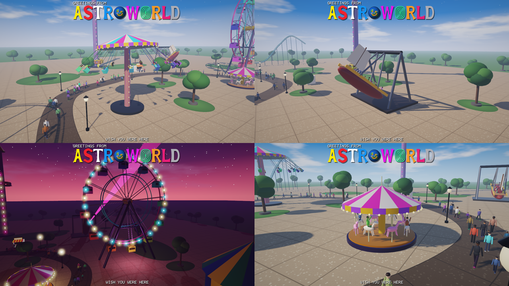

| Aerial | Path traced (same scene, CPU) |
|---|---|
| 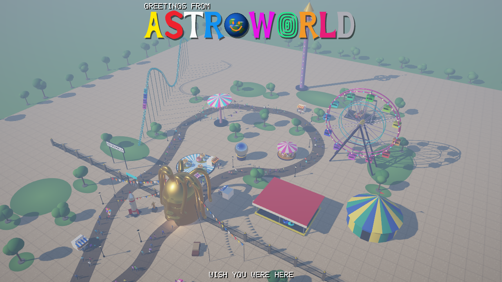 | 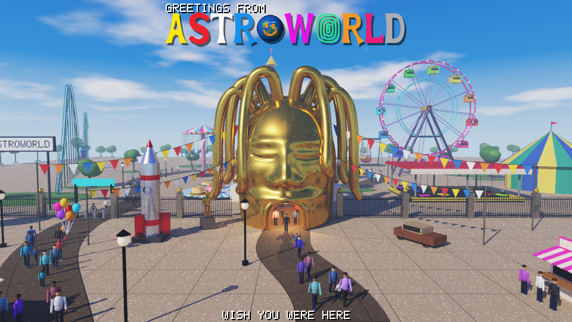 |

### What changed

**Photorealistic rendering (OpenGL)**

| Technique | Implementation |
|---|---|
| **Physically based shading** | Cook–Torrance microfacet BRDF: GGX normal distribution, Smith–Schlick geometry, Schlick Fresnel, with **metallic/roughness** materials. It replaces Blinn-Phong; the Phong model's ambient, diffuse and specular parts each become physically based ([shaders.h](src/glScene/shaders.h)). |
| Image-based ambient | Hemisphere irradiance from sky and ground, plus a roughness-blurred **environment reflection**, so the gold head mirrors the blue sky and the plaza like the photo |
| **Shadow mapping** | The scene is rendered from the sun into a 4096² depth texture (orthographic, because sunlight is parallel). Each pixel compares its depth with hardware PCF over a 3×3 kernel for soft edges, using polygon offset and a normal offset against acne ([framePipeline.cpp](src/gl/framePipeline.cpp)). |
| **HDR and tone mapping** | Lighting is computed in **linear** light into a 16-bit float, 4× MSAA buffer, then **ACES filmic** tone mapping, **gamma correction** (sRGB), exposure and a vignette |
| **Bloom** | A bright pass plus a separable Gaussian blur at half resolution make lamps, bulbs and the glowing mouth glow like they do through a real lens |
| Many lights | Up to 16 point lights per frame (the mouth, warm uplights on the head, lamp posts, rides, stalls), chosen nearest the camera; negligible lights are skipped per pixel |
| **GPU instancing** | About 1,400 instances are grouped by mesh and material, and each group is drawn in one call with per-instance model matrices and tints (`glVertexAttribDivisor`, `glDrawElementsInstanced`) |
| Atmosphere | A procedural sky with sun disc, glow and clouds; a warm horizon band and stars at night; distance fog |

**The inflatable head**
- **One sculpted surface:** ~130,000 triangles. The nose, pouting upper lip, closed eyelids (with crease lines), cheeks and brow are smooth bumps and creases *pushed out of the surface along its normals*, so they flow into each other like inflated vinyl. Faint **seams** run down the sides and back, as on a real inflatable.
- **A broad jaw:** below the cheekbones the cross-section eases from an ellipsoid into near-vertical sides, so the head stands on the ground instead of balancing on its tip.
- **A walk-through mouth:** the arch is cut out of the mesh front and back. A **tunnel** with glowing walls joins the two openings, and inflated lips cover the cut edges.
- **Dreads:** fat inflated tubes that arch over the crown, curl at the tips and sway in the wind.
- **Material:** gold vinyl (metallic 0.85, roughness 0.3) that reflects the environment.

**A bigger park with life in it**
- **The head is the entrance gate,** set in a palisade wall. The album cover's plaza is in front: the rocket, the gold statue, the wrecked car, the bunting and the balloon vendor. A separate exit gate stands in the wall.
- **New rides, each moved by physics or a transformation hierarchy:**
  - **Wave swinger:** the chairs hang at the angle where chain tension balances gravity against the centripetal force, tan θ = ω²r/g. The radius r grows as they swing out, so θ is found by fixed-point iteration. The spin follows keyframes and the canopy rocks.
  - **Pirate ship:** a pendulum with period T = 2π√(L/g), whose amplitude builds and dies away over each ride.
  - **Teacups:** three nested rotations (platform → turntables → cups).
  - **Bumper cars:** each car follows its own Lissajous curve and faces its direction of travel.
- **Larger classics:** a 30 m Ferris wheel, a 22 m coaster, a 40 m drop tower, the carousel, the big top, and a chrome "Astro globe" at the park's hub.
- **The world beyond:** food stalls, about 85 trees, lawns, lamp posts along the paths, and a meadow that runs to the horizon.
- **Visitors:**
  - ~140 walk a loop: in through the mouth, around the rides, out through the exit gate, and back round the plaza.
  - Their legs swing with the **distance walked**, so feet don't slide. Children and adults have different heights, with varied clothes and skin tones.
  - People queue at the stalls, and **riders** fill every ride.
- **Lighting at night:** lamp posts, ride lights and warm uplights at the foot of the head turn on with the day/night timeline, as on the night album cover.

**The ray tracer** uses the same PBR materials, lights, sky and ACES tone mapping, so it remains a reference for the real-time image.

| Whitted, day | Whitted, night |
|---|---|
| 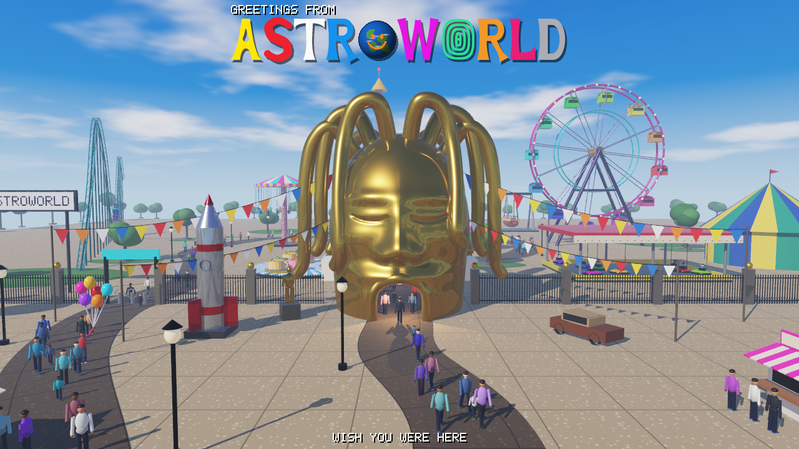 | 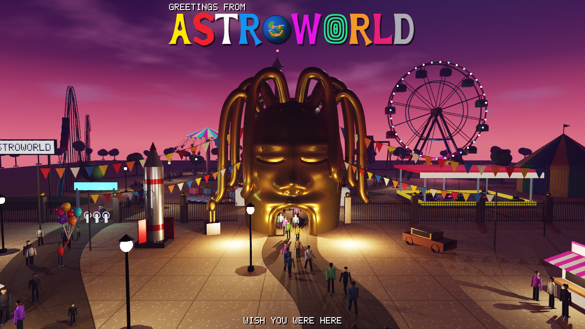 |

### Controls added
- `X` toggles sun shadows and `B` toggles bloom (`--no-shadows` and `--no-bloom` on the command line).
- `C` now cycles 11 viewpoints, including **The gate** (visitors walking in), **Inside the park**, **Swing ride** and **Pirate ship**.

### Performance and limitations
- **Frame rate:** on this machine, an integrated AMD Radeon behind WSL's Direct3D 12 translation, the park runs at about **28 fps by day and 22 fps at night**.
- **Where the time goes:** measured per frame,
  - building the scene: ~3.5 ms
  - GPU rendering: ~20 ms, about half of it the sky and post-processing
  - presenting through WSLg: ~7.5 ms

  Instancing cut draw calls from ~2,750 to ~300 per frame but didn't change fps much, which shows the integrated GPU's fragment work is now the limit. A discrete GPU would run it far faster.
- **Ray tracing cost:** the ray tracer now sees ~690,000 triangles. A 1280×720 Whitted frame takes ~13 s by day; path tracing takes about a minute at 960×540 with 48 samples and is still grainy.
- **Still stylised:** the visitors and trees are built from simple primitives. The head is sculpted procedurally rather than modelled, so its face is softer than the photographed inflatable.
