# ASTROWORLD

ASTROWORLD is a theme park built from the art of Travis Scott's *Astroworld* for a Computer Graphics capstone. The giant golden head is the entrance, with its open, glowing mouth as the gate. Around it are the "Greetings from ASTROWORLD" postcard lettering, the blue-sky carnival of the album cover and the starfield of the night artwork. The project starts as a software renderer in which every pixel comes from our own C++ code, and each stage of the course builds on the one before. Every stage lives on its own branch.

This is branch `main`: the latest work, the same as branch `blender` plus the video of the whole journey. [Earlier stages](#earlier-stages) are listed below, each on its own branch.

[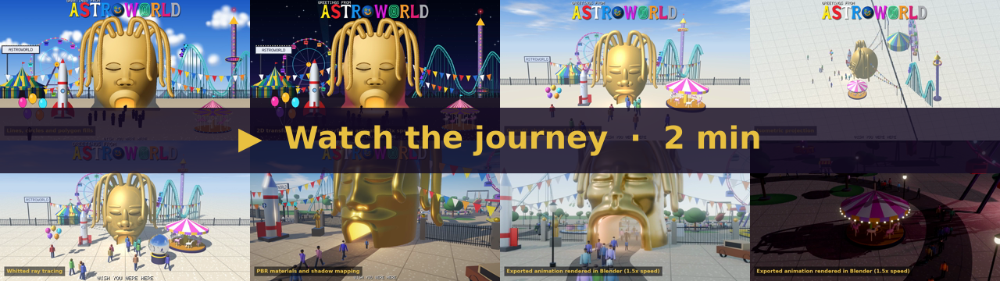](docs/media/astroworldJourney.mp4)

*The journey in two minutes: every stage, filmed with that stage's own code.*

## Contents

1. [Taking a step further: Blender](#taking-a-step-further-blender)
2. [Earlier stages](#earlier-stages)
3. [Project report](#project-report)
4. [Building and running](#building-and-running)
5. [Course concepts in the code](#course-concepts-in-the-code)
6. [The rendering pipeline](#the-rendering-pipeline)
7. [Project structure](#project-structure)
8. [Coding conventions](#coding-conventions)
9. [Branch guide](#branch-guide)
10. [Limitations](#limitations)

---

## Taking a step further: Blender

The latest stage keeps our C++ engine as the single source of truth for the park and hands the final image to Blender. The engine decides every mesh, every position on every frame, the ride physics and the lighting timeline. Blender adds what a production renderer does best: physically based materials, a physical sky, volumetric light, motion blur and a camera fly-through.

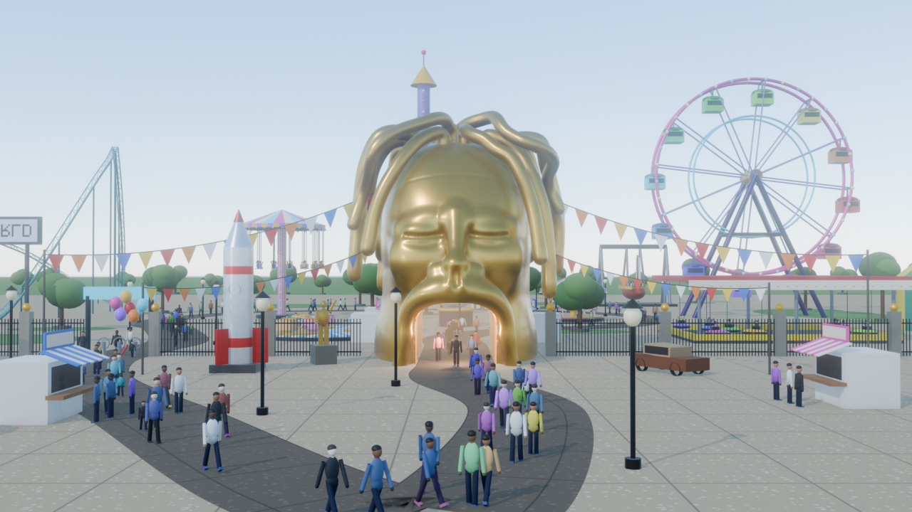

| The sculpted mouth | Through the tunnel | The swing ride at night |
|---|---|---|
| 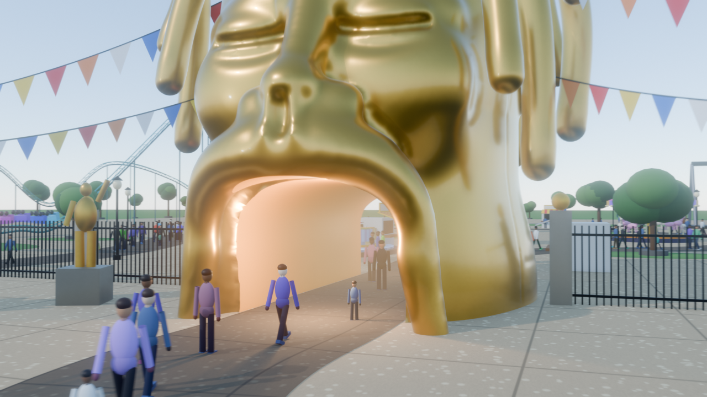 | 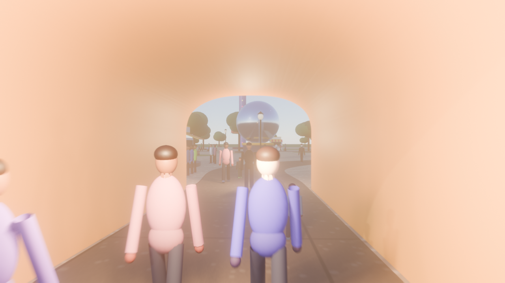 | 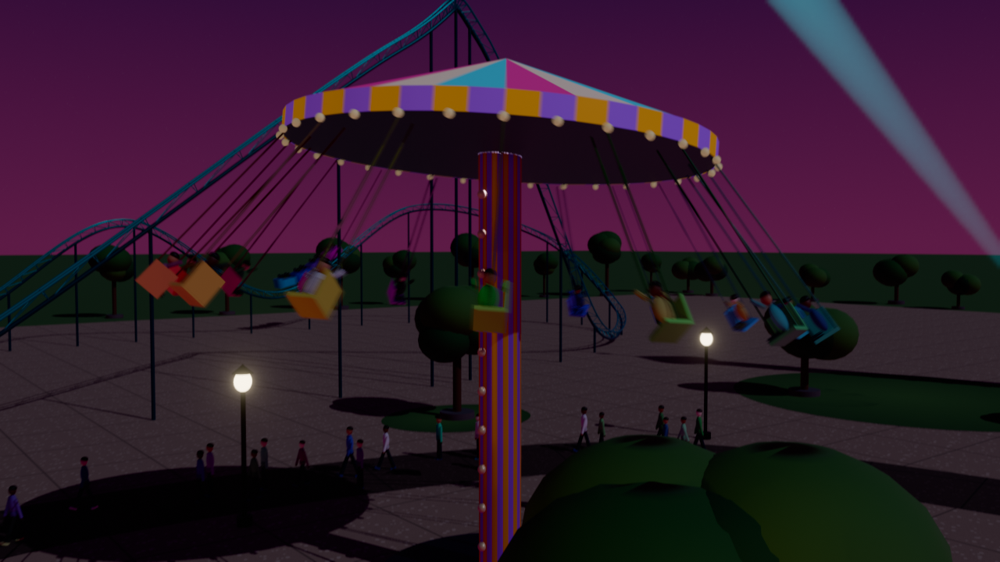 |

**The pipeline.**

| Step | What happens |
|---|---|
| Export ([exportMain.cpp](src/exportMain.cpp)) | `astroworldExport` samples `ParkScene` at 24 fps for 30 s. It writes each mesh once, and for every frame each object's model matrix, tint and emission. It also writes the lighting for every frame and the textures. |
| Build ([buildAstroworld.py](tools/blender/buildAstroworld.py)) | Blender rebuilds the meshes in bulk and shares each one between its instances, so 140 visitors use one torso. It adds Principled BSDF materials (gold vinyl with a clear coat, chrome, paving), a physical sky with a sunset and a starry night, searchlights inside glowing haze, AgX colour, bloom and motion blur. |
| Play ([astroworldPlayer.py](tools/blender/astroworldPlayer.py)) | A frame-change handler applies each exported frame, interpolating between frames for motion blur. It is embedded in the `.blend` file, so the park also moves when the file is opened in Blender. |
| Sculpted head ([head.blend](assets/blender/head.blend)) | The head, dreads and mouth tunnel were sculpted by hand in Blender, with the mouth left wide enough for the visitors' walking path. The build swaps them into the existing objects, so they keep their material, glow and animation. |

**A closed-circuit coaster.** The coaster used to be the 2D side profile lifted into 3D, so the train rose out of the ground and vanished at the far end. It is now a closed loop: station, chain lift to 24 m, first drop, camelback hills, a sweeping turn, brake run and back to the station.
- The track is a closed Catmull–Rom spline through 15 control points ([parkModels.cpp](src/park3d/parkModels.cpp)).
- The train's speed is integrated along it by arc length ([parkScene.cpp](src/park3d/parkScene.cpp)):
  - fixed speeds in the station and on the lift
  - after the crest, energy conservation with rolling friction: ½v² = ½v_c² + g(h_c − h) − μgs
  - a brake run capped at √(v_station² + 2ad)
- The train peaks at about 21.5 m/s, and one lap takes exactly 30 seconds, so the animation loops seamlessly.

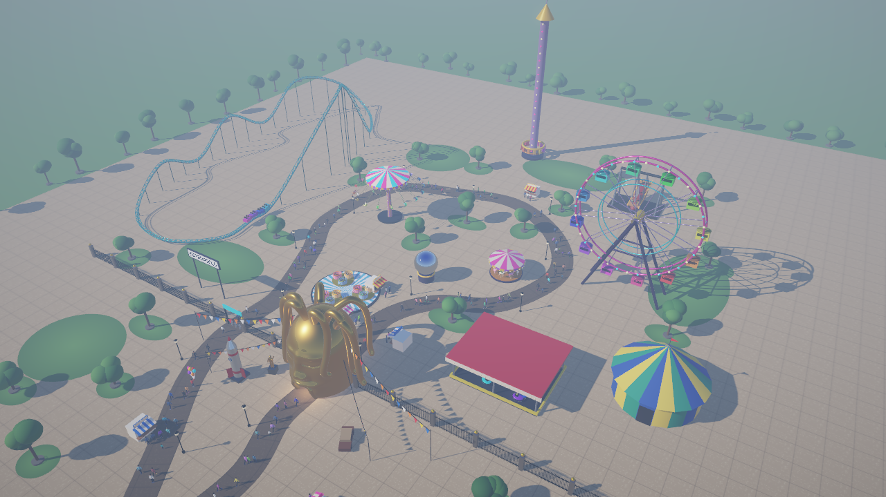

**Lessons.**
- A Subdivision modifier on each of about 500 visitor objects pushed a frame to 150 s. Subdividing the shared meshes once brought a 720p frame down to 16–34 s, and the full 720-frame film takes about 2½ hours.
- A volume across the whole world turned the night black in EEVEE. Local volumes in the beams and the mouth give the same look cheaply.
- Windows Blender reads WSL files over a network share, so the frame data is read in a single pass.

---

## Earlier stages

Newest first. Each stage is on its own branch, with a README describing it as it stood.

### 1. Taking a step further: photorealism

Branch [`photorealism`](https://github.com/Karanei-Kimutai/ASTROWORLD/tree/photorealism)

The real-time park made photoreal: physically based materials, shadow mapping, HDR with ACES tone mapping, bloom and GPU instancing. The inflatable gold head becomes the entrance, and about 140 visitors walk through its mouth into a much larger park.

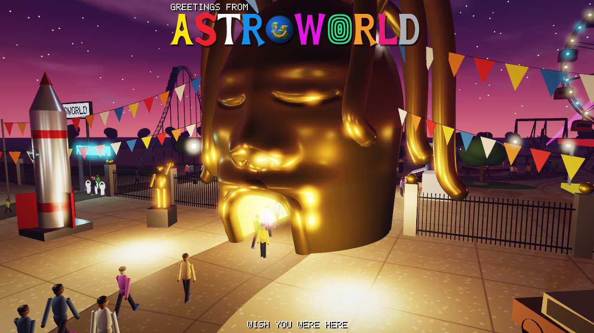

### 2. Checkpoint 4: ray tracing and path tracing

Branch [`checkpoint-4`](https://github.com/Karanei-Kimutai/ASTROWORLD/tree/checkpoint-4)

A CPU Whitted ray tracer and a path tracer that render the same 3D scene as the OpenGL park, with a BVH and supersampling.

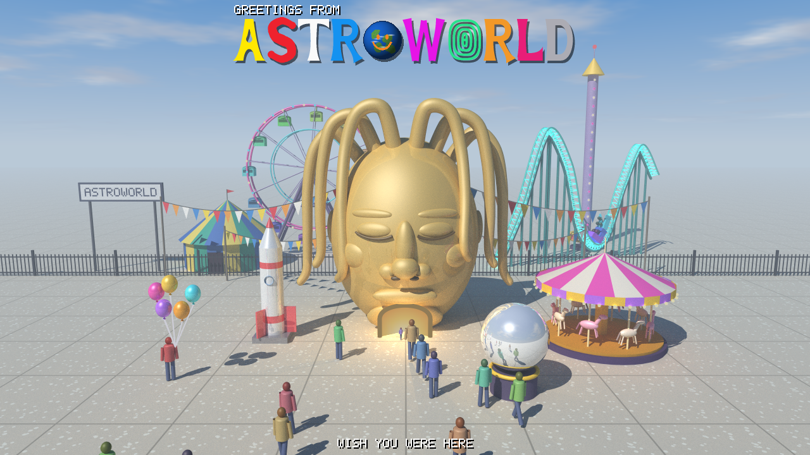

### 3. Prototype

Branch [`prototype`](https://github.com/Karanei-Kimutai/ASTROWORLD/tree/prototype) · all components combined

Every component in one interactive OpenGL program: a renderer-independent scene description, live flat, Gouraud and Phong shading, every projection type, mipmapped textures and a first-person coaster ride.

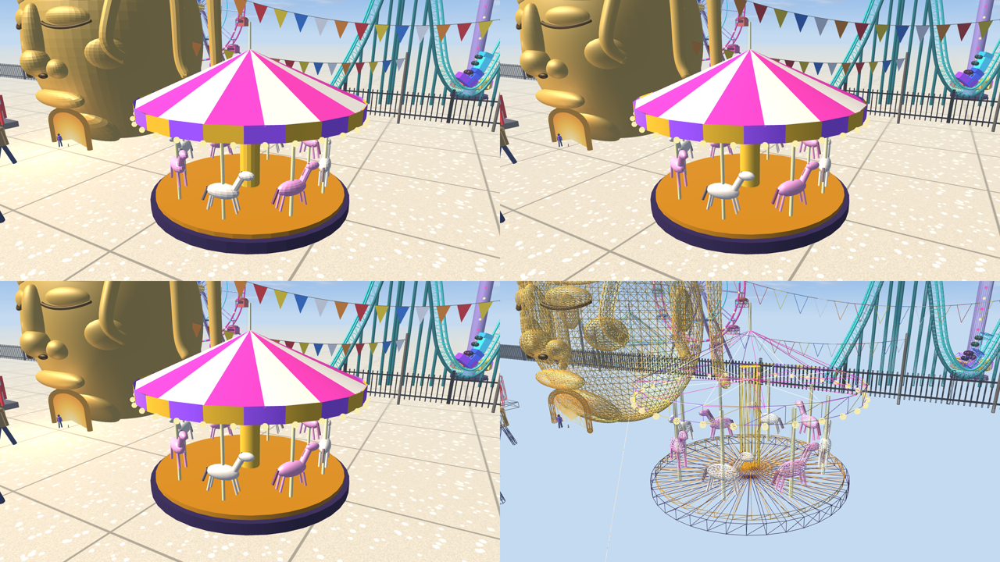

### 4. Checkpoint 3: OpenGL integration

Branch [`checkpoint-3`](https://github.com/Karanei-Kimutai/ASTROWORLD/tree/checkpoint-3)

The park rebuilt in real-time 3D with OpenGL 3.3 core: procedural meshes, GLSL shaders, Blinn-Phong lighting, a depth buffer, MSAA and an orbit camera, all driven by our own matrices.

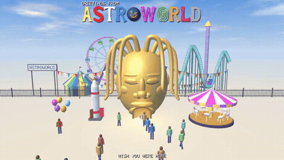

### 5. Checkpoint 2: transformation and animation

Branch [`checkpoint-2`](https://github.com/Karanei-Kimutai/ASTROWORLD/tree/checkpoint-2)

Homogeneous 2D and 3D transformations bring the 2D park to life: turning rides, a physics-timed coaster, a walking crowd and a 30-second day-to-night loop, exported as video.


### 6. Checkpoint 1, windowed variant

Branch [`checkpoint-1-window`](https://github.com/Karanei-Kimutai/ASTROWORLD/tree/checkpoint-1-window)

The Checkpoint 1 renderer shown live through SDL2, which only presents the finished frame.

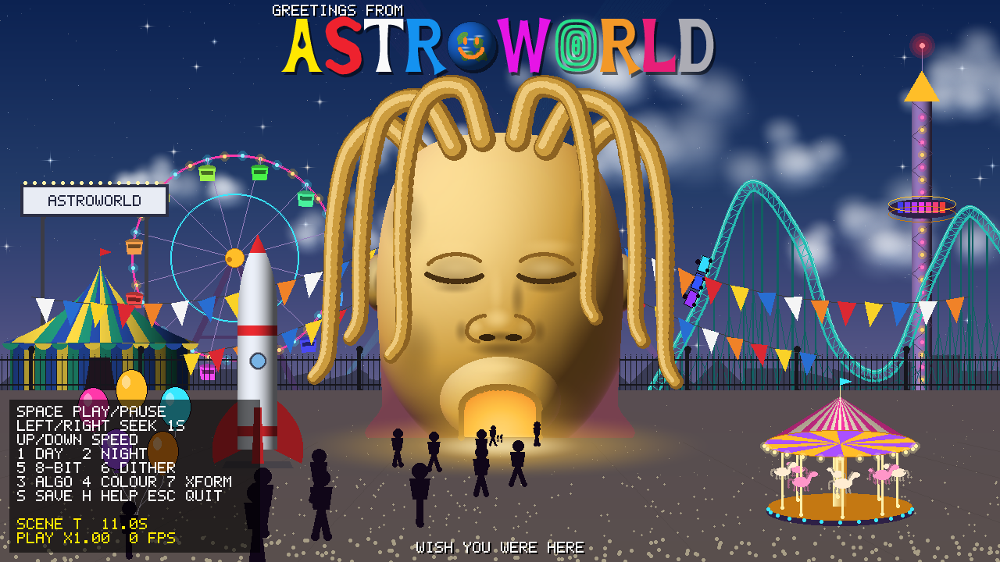

### 7. Checkpoint 1: technical foundation

Branch [`checkpoint-1`](https://github.com/Karanei-Kimutai/ASTROWORLD/tree/checkpoint-1)

The course's raster algorithms written by hand in C++ (lines, circles, ellipses, clipping, curves, fills and colour models) and used to draw the park as still images.

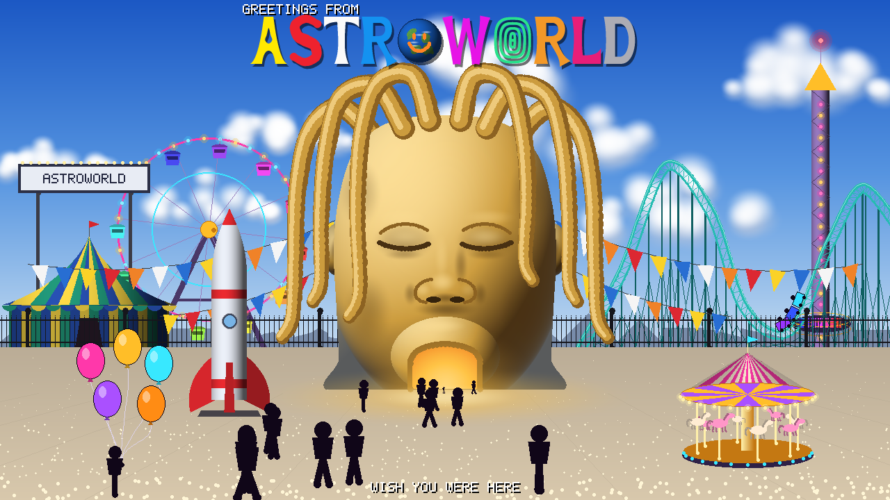

---

## Project report

The Checkpoint 4 report, brought up to date with the project as it now stands.

### Demonstration

1. **The software renderer** (`astroworldWindow`). The algorithm, colour and transformation showcases, then the day-to-night animation, all drawn by our own rasterization code.
2. **The OpenGL park** (`astroworldGl`).
   - The viewpoints, including one-, two- and three-point perspective, and the gate.
   - The isometric, oblique and multiview projections.
   - Flat, Gouraud and Phong shading over physically based materials.
   - Shadows and bloom switched on and off.
   - Texturing with and without mipmaps.
   - The coaster ride at night.
3. **The ray tracer** (`astroworldRay`). A small Whitted frame rendered live, which prints its BVH and rays-per-second statistics, and the pre-rendered path-traced images.
4. **The Blender film** (`output/astroworldBlender.mp4`), with the `.blend` open in Blender to scrub through the animation.
5. **CPU against GPU.**
   - The software renderer runs at 15–20 fps.
   - The Checkpoint 3 OpenGL scene runs at about 83 fps on the GPU and about 14 fps on the CPU.
   - The ray tracer takes seconds to minutes per frame.
   - The film takes about 25 s per frame in Blender.

### What works

- **Every course topic is implemented and can be seen**, and each one is mapped to its code under [course concepts](#course-concepts-in-the-code):
  - raster and vector graphics, colour models and 8-bit reduction
  - the line, circle, ellipse, curve and fill algorithms, and clipping
  - 2D and 3D homogeneous transforms and every projection
  - the Phong model with three shading modes, and texture mapping with mipmaps
  - ray tracing, path tracing, and both supersampling and multisampling
- **One park, four ways to draw it:** the software renderer, OpenGL, the ray tracer and Blender. They share the palette, curves, matrices and animation timeline, and the three 3D renderers draw the identical `ParkScene`.
- **Real-time photorealism:** physically based materials, shadow mapping, HDR with ACES tone mapping, bloom and instancing.
- **A living park:** the walk-through head, physics-driven rides, about 140 visitors, and a 30-second loop from day to night and back on a closed-circuit coaster.
- **Interaction and output:** full camera control, eleven viewpoints, six projections, three shading modes, the coaster ride, and stills, video and film, all scriptable from the command line.

### Recommendations

- Rigged, animated characters for the visitors, for example from Mixamo.
- Bringing the hand-sculpted head into the OpenGL park and the ray tracer, so every renderer shows the same face.
- A faster ray tracer: a surface-area-heuristic BVH, SIMD ray packets, a denoiser and progressive rendering in the window.
- Volumetric light in the ray tracer, so the searchlight beams appear there too.
- Testing on a discrete GPU and on native Windows and macOS.
- Sound.

---

## Building and running

**Requirements:** a C++17 compiler (g++ 9+ / clang 10+ / MSVC 2019+) and, optionally, CMake 3.16+. The software renderer uses **no external libraries**. Optional targets, which CMake skips when their library is missing:
- `astroworldWindow` (live player for the software renderer) needs **SDL2**: `sudo apt install libsdl2-dev`
- `astroworldGl` (CP3, OpenGL 3.3 core) needs **GLFW** and the Khronos GL headers: `sudo apt install libglfw3-dev` (the headers come with Mesa's dev packages)

The ray tracer `astroworldRay` needs no libraries beyond the C++ standard library (it uses `std::thread`).

`ffmpeg` is only used to encode videos and convert screenshots: every pixel is drawn by our own code.

`build/` and `output/` are not tracked by git, so after switching branches they still hold the programs and images of the last branch you built. Rebuild from scratch on each branch:

```bash
rm -rf build && cmake -B build && cmake --build build -j
```

### With CMake

```bash
cmake -S . -B build
cmake --build build
./build/astroworld          # write every still image as a PPM file
./build/astroworldWindow    # play the software-rendered animation live in a window
./build/astroworldGl        # CP3: the 3D park in OpenGL
./build/astroworldRay       # Checkpoint 4: ray trace the 3D park (add --mode path for path tracing)
./tools/makeVideo.sh        # render the 30 s animation loop to output/astroworldAnimation.mp4
./tools/makeVideo.sh 30 30 opengl   # ...or the OpenGL version to output/astroworldAnimationGl.mp4
```

### Without CMake

```bash
# Software renderer only (the other programs need CMake's dependency detection):
g++ -std=c++17 -O2 -Wall -Wextra -Isrc src/main.cpp $(find src -name '*.cpp' ! -name '*Main.cpp' ! -name main.cpp \
    ! -path 'src/gl*' ! -path 'src/park3d/*' ! -path 'src/mesh/*' ! -path 'src/raytrace/*') -o build/astroworld
```

### OpenGL park (`astroworldGl`, Checkpoint 3 and prototype)

<details><summary>Controls and options</summary>

| Input | Action |
|---|---|
| Mouse drag / scroll | Orbit the camera / zoom |
| `W` `A` `S` `D` / `Q` `E` | Move the camera's target / up and down |
| `C` | Cycle the 11 viewpoints: album cover, aerial, Ferris wheel, carousel, one-, two- and three-point perspective, swing ride, pirate ship, inside the park, the gate |
| `X` / `B` | Toggle sun shadows / bloom |
| `R` | Ride the roller coaster (first-person camera on the front car) |
| `V` | Cycle projections: perspective, isometric, oblique cavalier, oblique cabinet, top view, front view |
| `G` / `F` | Cycle shading (flat, Gouraud, Phong) / toggle wireframe |
| `T` / `M` | Toggle texture mapping / mipmapping |
| `O` | Toggle automatic orbit |
| `Space`, `←` / `→`, `↑` / `↓` | Play / pause, seek ±1 s, speed ×2 / ÷2 |
| `1` / `2` | Jump to day / night |
| `L` / `H` | Toggle the logo overlay / help panel |
| `P` | Save a screenshot to `output/` |
| `Esc` | Quit |

Command-line options:
- `--camera <0-10>`, `--projection <0-5>` and `--shading <0-2>` pick the starting viewpoint, projection and shading.
- `--ride`, `--wireframe`, `--no-logo`, `--no-textures`, `--no-mipmaps`, `--no-shadows` and `--no-bloom` match the keys above, so every mode can be captured from scripts.
- `--time <s>` sets the starting time.
- `--capture <file.ppm>` renders one frame off-screen and exits.
- `--animate <seconds> <fps> <dir | ->` renders a frame sequence, exactly like the software renderer.
- `--duration <s>` closes the window after that many seconds and prints the average FPS.
- `--software` forces Mesa's CPU rasterizer instead of the GPU.

</details>

**GPU selection under WSL:** by default Mesa renders OpenGL on the CPU (`llvmpipe`). WSL's `d3d12` driver forwards OpenGL to the real GPU through `/dev/dxg`, so the program selects it automatically when that device exists (it sets `GALLIUM_DRIVER=d3d12` unless you have set it yourself).

### Ray tracer (`astroworldRay`, Checkpoint 4)

```bash
./build/astroworldRay                                  # Whitted, 9 samples/pixel, day   (~13 s)
./build/astroworldRay --time 18                        # ...at night
./build/astroworldRay --mode path --samples 128        # path traced with global illumination (~3 min)
./build/astroworldRay --camera 1 --projection 1        # any viewpoint and projection from the OpenGL viewer
```

Options:
- `--mode whitted|path`, `--samples n` (per pixel), `--depth n` (reflection depth / bounces)
- `--width`, `--height`, `--time`, `--camera`, `--projection`
- `--threads`, `--no-logo`, `--output file.ppm`

It prints the triangle count, BVH build time, render time and rays per second. This branch's park is far larger than the Checkpoint 4 scene (about 690,000 triangles against 92,000): a 1280×720 Whitted frame takes about 13 s on 12 threads, and path tracing about a minute at 960×540 with 48 samples. The Checkpoint 4 timings are on the [`checkpoint-4`](https://github.com/Karanei-Kimutai/ASTROWORLD/tree/checkpoint-4) branch.

### Live window (software renderer)

`astroworldWindow` runs exactly the same pure C++ renderer and plays the animation in real time. SDL2 only handles the last pipeline stage, **display**: each finished `FrameBuffer` is uploaded to a streaming texture (`SDL_PIXELFORMAT_RGB24` has the same byte layout as our `Color`, so nothing is converted) and presented in a resizable, letterboxed window.

Every frame, the real elapsed time (times the playback speed) is added to the animation clock and the scene is rendered for that time. Because each frame is a pure function of time, the motion runs at the right speed at any frame rate, and seeking is instant. A frame takes about 50–70 ms on the CPU (roughly 15–20 fps). That limit is the reason CP3 moves rendering to the GPU.

<details><summary>Controls and options</summary>

| Key | Action |
|---|---|
| `Space` | Play / pause |
| `←` / `→` | Seek −1 s / +1 s |
| `↑` / `↓` | Playback speed ×2 / ÷2 (0.25× to 4×) |
| `1` / `2` | Jump to day (t = 0) / night (t = 18 s) |
| `5` / `6` | Scene reduced to 8-bit / 8-bit dithered (still animating) |
| `3` / `4` / `7` | Algorithm / colour / transformation showcase |
| `S` | Save the current image to `output/window_<view>.ppm` |
| `H` | Show / hide the help overlay (with live FPS) |
| `Esc` / `Q` | Quit |

Command-line options: `--time <seconds>` sets the starting animation time. `--capture <file.ppm>` renders one frame, reads it **back** from the renderer with `SDL_RenderReadPixels`, saves it and exits; add `--with-help` to keep the overlay. The capture at t = 0 matches `astroworld`'s PPM still byte for byte, which shows the window displays the frame buffer exactly.

</details>

### Animation and video

```bash
./build/astroworld --animate <seconds> <fps> <directory>   # frame_00000.ppm, frame_00001.ppm, ...
./build/astroworld --animate 30 30 - | ffmpeg ...          # stream frames on stdout (no files)
./tools/makeVideo.sh [seconds] [fps]                       # MP4 + README GIF preview
```

`makeVideo.sh` pipes the raw PPM frames straight into ffmpeg, so 900 frames (≈2.4 GB of raw pixels) are never written to disk. A full 30 s loop at 30 fps takes about a minute to render.

### Output

Running `./build/astroworld [outputDirectory]` (default `output/`) writes:

| File | What it shows |
|---|---|
| `astroworldDay.ppm` | The park as on the album cover (24-bit colour) |
| `astroworldNight.ppm` | The same park at night: starfield, searchlights, brighter portal |
| `astroworldDay8Bit.ppm` | Day scene reduced to 256 colours (3-3-2 RGB) |
| `astroworldDay8BitDither.ppm` | 256 colours with 4×4 ordered (Bayer) dithering |
| `algorithmShowcase.ppm` | Every CP1 algorithm shown on its own, labelled |
| `colorShowcase.ppm` | HSV, tints/shades/tones, RGB vs CMYK, colour depth, palette |
| `transformShowcase.ppm` | Every CP2 transformation shown on its own, labelled |

To regenerate the PNGs in `docs/screenshots/`:

```bash
./tools/exportScreenshots.sh
```

### Blender render

Requires Blender 4.2 or later (developed on 5.2, a Windows install driven from WSL). `tools/blender/render.sh` exports the park from our engine and then builds or renders it:

```bash
tools/blender/render.sh scene                  # build the .blend (also copied to Documents\ASTROWORLD-Blender on Windows)
tools/blender/render.sh stills 1,145,313,720   # quick preview frames -> output/blender/stills/
tools/blender/render.sh still 313              # one full-quality EEVEE frame
tools/blender/render.sh cycles 313             # one path-traced Cycles frame
tools/blender/render.sh animation              # all 720 frames -> output/astroworldBlender.mp4
```

`HEAD=none` uses the procedural head instead of the sculpt; `HEAD_PARTS=dreads` uses only some of the sculpted parts.

---

## Course concepts in the code

### Hardware and core fundamentals
| Concept | Implementation |
|---|---|
| **Raster vs. vector** | The bitmap font ([bitmapFont.cpp](src/text/bitmapFont.cpp)) is a *raster* font: it goes blocky when scaled (see the captions). The logo ([astroWordmark.cpp](src/text/astroWordmark.cpp)) is *vector*: its letters are described by curves and polygons, so it stays smooth at any size. |
| **Frame buffer** | [frameBuffer.h](src/core/frameBuffer.h): a row-major pixel array, the CPU-side equivalent of the VRAM frame buffer. "Display" means writing it to a PPM file, or, in the windowed build, uploading it to video memory as a texture (and reading it back with `--capture`). |
| **CPU vs. GPU** | Measured on this machine: the CP2 software renderer manages ~15–20 fps. The CP3 OpenGL renderer, a far heavier 3D scene, runs at **~83 fps on the GPU** (AMD Radeon via D3D12) but only **~14 fps** when the same OpenGL code runs on Mesa's CPU rasterizer (`--software`). The GPU processes thousands of vertices and fragments in parallel. |

### Colour theory and models
| Concept | Implementation |
|---|---|
| RGB / HSV / CMYK | `hsvToRgb`, `rgbToHsv`, `rgbToCmyk`, `cmykToRgb` in [color.cpp](src/core/color.cpp). Demonstrated in the colour showcase. |
| Hue, saturation, value; tints, shades, tones | `makeTint`, `makeShade`, `makeTone`. The Ferris wheel gondolas space their hues evenly around the HSV wheel. |
| Colour harmony | `astroPalette`, sampled from the album artwork: complementary blue sky against brass/gold for the day, navy against neon for the night, and a full-spectrum rainbow for the logo letters. |
| 24-bit → 8-bit reduction | `reduceTo8Bit` / `expandFrom8Bit` (3-3-2 RGB) plus Bayer dithering in `FrameBuffer::reducedTo8Bit`. |
| HSV interpolation | `lerpColorHsv`: the sky gradient goes the short way round the hue circle; `nightAmount` blends the day and night palettes. |

### Geometric primitives and drawing algorithms
| Algorithm | Where it is used in the park |
|---|---|
| **DDA line** ([lines.cpp](src/raster/lines.cpp)) | Searchlight rays, concrete joints in the plaza; the clipping demo |
| **Bresenham line** (integer decision parameter) | Ferris wheel spokes, the coaster's lattice truss, fence pickets and rails, star flares, bunting strings |
| **Midpoint circle** (8-way symmetry) ([circles.cpp](src/raster/circles.cpp)) | Ferris wheel rims and hub, light bulbs, the globe, round stroke caps |
| **Midpoint ellipse** (4-way symmetry, two regions) | Carousel, balloons, ears, lips, clouds, glows and soft shadows |
| **Line clipping** (Cohen–Sutherland) ([clipping.cpp](src/raster/clipping.cpp)) | Searchlight rays are 2200 px long and are clipped to the screen; plaza joints are clipped to the ground |

### Curves
| Concept | Where it is used |
|---|---|
| Parametric curves | Every curve is evaluated as a function of `t ∈ [0, 1]` |
| **Bézier curves** ([bezier.cpp](src/curves/bezier.cpp)) | Eyelids, nose creases, the mouth arch, the bowls of R and D, the A's outline, the rocket's nose and fins, the tent roof, sagging bunting, balloon strings |
| **Splines** (Catmull–Rom, [spline.cpp](src/curves/spline.cpp)) | Coaster track, head silhouette, the dreads, the S's spine, teardrop counters, the continents on the globe |

### Polygons and area filling
| Concept | Where it is used |
|---|---|
| **Scan-line fill** (ET + AET, even-odd) ([scanLineFill.cpp](src/fill/scanLineFill.cpp)) | Sky, ground, head, logo letters, skyline (highly concave), tent, rocket, pennants, gondolas, cars |
| **Boundary fill** (4- vs 8-connected) ([boundaryFill.cpp](src/fill/boundaryFill.cpp)) | Balloons. The showcase shows why 8-connected fill leaks through diagonal Bresenham outlines |
| Convex / concave / complex polygons | The showcase fills a concave star and a self-intersecting pentagram (hollow centre under the even-odd rule) |

### 2D and 3D transformations (CP2)
| Concept | Where it is used |
|---|---|
| **Homogeneous coordinates** | [matrix3.h](src/math/matrix3.h): 2D points are `(x, y, 1)` and directions `(x, y, 0)`, so translation is a matrix product like everything else. [matrix4.h](src/math/matrix4.h) does the same in 3D with `(x, y, z, 1)`. |
| **Translation** | Clouds drift (with parallax and wrap-around); visitors walk to the mouth; every model matrix starts with `T(position)` |
| **Rotation** | The Ferris wheel turns about its hub; coaster cars are rotated to the track's slope; pennants flutter |
| **Rotation about a pivot** `T(p)·R·T(−p)` | Dreads bend about their roots; balloons sway about the vendor's hand; walking legs swing about the hip |
| **Scaling about a fixed point** `T(p)·S·T(−p)` | The inflatable head "breathes" about its base so the mouth stays on the ground; visitors shrink to nothing as they step into the light |
| **Composite transforms / order** | `model = S_about(base) · T(center) · S(scale)` for the head; the showcase shows `T·R ≠ R·T` |
| **Hierarchical transforms** | Ferris wheel: `wheel = T(hub)·R(θ)`, `spoke_i = wheel·R(i·30°)`, and gondolas take only the spoke's position so they hang level |
| **4×4 matrices in 3D** | Carousel horses: `Rx(tilt) · Ry(θ + i·45°)` places each horse in 3D; depth (z) sorts them back to front |
| **Shear, reflection** | Transformation showcase (panel 4) |

### Projections
| Concept | Where it is used |
|---|---|
| **Orthographic: multiview** | `V` → top view (true plan) and front view (true elevation): parallel projectors perpendicular to the view plane |
| **Orthographic: axonometric / isometric** | `V` → isometric: the camera looks down the cube diagonal (elevation atan(1/√2) ≈ 35.26°, 45° around), so the x, y and z axes are equally foreshortened |
| **Oblique: cavalier, cabinet** | `V` → `Matrix4::obliqueShear` shears depth onto a 45° diagonal before an orthographic projection: full depth (cavalier) or half depth (cabinet) |
| **Perspective, centre of projection, frustum** | Default mode: `Matrix4::perspective` with the eye as the centre of projection; the GPU clips to the view frustum and divides by *w* |
| **One-, two- and three-point perspective** | `C` presets: a level camera square to the fence (one vanishing point: only depth lines converge); turned 45° (two: both ground axes converge); tilted up at the drop tower (three: verticals converge too) |
| CP2 parallel uses | Carousel horses (z dropped after the view rotation); the showcase cube uses `Matrix4::orthographic` |
| Camera / view transform | `Matrix4::lookAt` builds the view matrix from the orbit camera's eye (spherical coordinates around a target) |
| Viewport transform | NDC `[−1, 1]` → pixels: `glViewport` in OpenGL; done by hand in the transformation showcase |

### OpenGL (CP3)
| Concept | Implementation |
|---|---|
| Programmable pipeline | [shaders.h](src/glScene/shaders.h): the vertex shader applies `projection · view · model`; the fragment shader lights each sample |
| Function loading | [glFunctions.h](src/gl/glFunctions.h): every GL ≥ 1.2 function is looked up in the driver at runtime, as GLAD does |
| Vertex buffers | [glResources.cpp](src/gl/glResources.cpp): meshes go into VBOs/EBOs, described by a VAO (position, normal, colour, UV attributes) |
| Hidden-surface removal | The **depth buffer** (z-buffer) replaces CP1/CP2's painter's algorithm |
| **Lighting (Phong model)** | Blinn-Phong per fragment from Checkpoint 3 to Checkpoint 4: ambient, diffuse and specular from the sun or moon, plus an attenuated **point light** in the mouth. On the photorealism branch a physically based Cook–Torrance model takes its place, with shadow mapping, HDR and bloom; the three shading modes below apply to it unchanged. |
| **Shading interpolation: flat / Gouraud / Phong** | `G` switches live. **Flat**: one normal per triangle from the screen-space derivatives of the position (`cross(dFdx, dFdy)`), so facets show. **Gouraud**: the Phong model is evaluated per *vertex* in the vertex shader and the colours are interpolated, so highlights smear and can be missed. **Phong**: the *normal* is interpolated and lighting runs per pixel. All three share one GLSL lighting function. `F` shows the wireframe. |
| Normal transformation | Normals use the inverse-transpose of the model matrix (in the shader, and in `MeshData::append`), so ellipsoid features stay correctly lit |
| **Texture mapping** | The plaza uses a 4 m concrete slab with joints and popcorn, drawn by the software renderer and **tiled** 100× with `GL_REPEAT`. The park sign's lettering is a UV-mapped texture; the logo and captions are textured screen-space quads. `T` toggles texturing. |
| **Mipmapping** | The ground texture has a full mip chain (`glGenerateMipmap`) with trilinear filtering. `M` switches to point sampling to show the shimmering aliasing on distant slabs that mipmaps remove. |
| Transparency | Searchlight beams use **additive blending** with depth writes off, fading along their length |
| **Anti-aliasing (MSAA)** | The scene renders into an off-screen 4× multisampled frame buffer object, resolved and then shown or read back |
| Procedural sky | A full-screen triangle reconstructs each pixel's view ray with the inverse view-projection matrix, then adds a gradient, value-noise clouds and twinkling stars |
| Fog | Exponential distance fog toward the horizon colour (aerial perspective) |
| Frame buffer read-back | `glReadPixels` turns GPU frames back into our `FrameBuffer` for screenshots and video |

### Scene description (prototype)
| Concept | Implementation |
|---|---|
| Scene graph / instancing | [parkScene.h](src/park3d/parkScene.h): the park at time *t* is a list of instances (mesh + model matrix + material) plus lighting. The OpenGL renderer draws that list; the Checkpoint 4 ray tracer traces the same list. One mesh (a gondola, a horse, a visitor) is drawn many times with different matrices and tints. |
| Camera paths | The coaster ride camera follows the spline: eye at the front car, looking a few metres ahead along the track, banked with the car's up vector |

### Reusing earlier work in CP3
| From | Used in the OpenGL renderer for |
|---|---|
| `Matrix4` (CP2) | Every model, view and projection matrix, uploaded column-major. GLM is not needed. |
| Catmull–Rom splines (CP1) | 3D coaster track and the dreads (`sampleCatmullRomSpline3D`) |
| Bézier curves (CP1) | Closed-eye lash lines, the doorway arch, bunting sag |
| `astroworldTimeline` (CP2) | The same day/night keyframes, drop-tower keyframes and coaster physics, so both renderers stay in sync |
| `astroHeadShape` (CP1/CP2) | The same dread centre lines and doorway outline, wrapped onto an ellipsoid |
| Software renderer (CP1) | Draws the logo, captions, sign lettering and help panel; **difference matting** turns them into RGBA textures |
| Palette and colour maths (CP1) | Vertex colours, day/night lerps, HSV-spaced gondola and car colours |

### Animation (CP2)
| Concept | Where it is used |
|---|---|
| Time-based animation | Every frame is a pure function of `timeSeconds`, so playback is frame-rate independent and any frame can be rendered alone |
| **Keyframes + easing** ([keyframeTrack.h](src/animation/keyframeTrack.h), [easing.h](src/animation/easing.h)) | Drop tower: ease-in-out climb, pause, then a drop that accelerates and bounces (`easeOutBounce`). Day → dusk → night → dawn: smoothstep keyframes over a 30 s loop |
| Physically based motion | Coaster: constant-speed chain lift, then speed from energy conservation `v = √(v₀² + 2g·Δh)`, integrated along the spline by arc length |
| Procedural motion | Sine oscillators for swinging gondolas, bobbing horses, breathing head, swaying dreads, balloons and bunting, twinkling stars and sweeping searchlights |
| Walk cycle | Visitors' legs swing about the hip in opposite phase, with a bounce on each step |

### Ray tracing, path tracing and anti-aliasing (Checkpoint 4)
| Concept | Implementation |
|---|---|
| **Ray casting** | [rayTracer.cpp](src/raytrace/rayTracer.cpp): each pixel is *unprojected* through the inverse view-projection matrix to get its ray, so every projection works (parallel rays for orthographic views) |
| Ray-triangle intersection | Möller–Trumbore: solve origin + t·d = P₀ + u·E₁ + v·E₂ with Cramer's rule; the barycentric (u, v) interpolate normals, colours and texture coordinates |
| Acceleration structure | [rayGeometry.cpp](src/raytrace/rayGeometry.cpp): a **BVH** (bounding volume hierarchy) with median splits; slab tests let a ray skip whole subtrees, so ~92 000 triangles cost only a handful of tests per ray |
| **Whitted ray tracing** | Shadow rays to the sun and the portal light give hard shadows; recursive mirror rays reflect the park in the chrome ball, the rocket, the coaster and (subtly) the brass head |
| **Path tracing / global illumination** | Monte-Carlo solution of the rendering equation: cosine-weighted diffuse bounces, mirror bounces chosen with probability = reflectivity, next-event estimation (explicit shadow rays) for the sun and portal, emissive bulbs and doorway as area lights, sky light from bounced rays, and Russian roulette to end paths without bias |
| **Anti-aliasing (supersampling)** | Each pixel averages several **stratified, jittered** samples (a grid with one random point per cell), smoothing edges and texture detail |
| Tone mapping | Path-traced radiance above 1.0 is compressed with extended Reinhard instead of being clipped |
| Parallelism on the CPU | Rows are handed out to all hardware threads through an atomic counter (dynamic load balancing) |
| Same scene as OpenGL | The tracer flattens the same `ParkFrame` instances; line meshes become thin tubes, and the sky shader is ported to C++ |

### Rendering techniques
| Concept | Implementation |
|---|---|
| Painter's algorithm | Scene drawn far to near; carousel horses and crowd members are sorted by depth; outer dreads go behind the head, front dreads in front |
| Fragment shading | `PixelShader` callbacks colour each covered pixel (sky gradients, tent and canopy stripes, brass lighting, the portal glow) |
| Fragment discard | Rows below the ground line are discarded when filling the head and lips; continents are discarded outside the globe |
| Alpha blending | `FrameBuffer::blendPixel` and `blendSoftEllipse` (alpha falls off per pixel): clouds, glows, beams, sculpted shadows |
| Stencil mask | [coverageMask.h](src/core/coverageMask.h): letter pieces are *added* and counters *erased* off-screen, then composited |
| **Anti-aliasing** (SSAA) | The logo masks are rendered at 3×3 sub-samples per pixel and box-filtered down, so letter edges are smooth |
| Lighting (preview) | [brassShading.h](src/scene/brassShading.h) rebuilds an ellipsoid normal per pixel and applies diffuse, specular and rim terms. The dreads fake a lit cylinder with three offset tapered strokes. From Checkpoint 3 on, the OpenGL renderer replaces this with a real lighting model. |

---

## The rendering pipeline

| Pipeline stage | Software renderer (CP1 + CP2) |
|---|---|
| 1. Application | `renderAstroworldScene` decides what to draw and in what order |
| 2. Vertex processing | Model matrices (`Matrix3`) move every shape's local points into screen space. Carousel horses go through model → view → parallel projection with `Matrix4`. |
| 3. Primitive assembly | Points become polylines, polygons and ellipses |
| 4. Clipping | Cohen–Sutherland for lines; span clipping and bounds checks in `FrameBuffer` |
| 5. Rasterization | DDA, Bresenham, midpoint circle/ellipse and scan-line fill emit pixels or spans through `PlotCallback` / `SpanCallback` |
| 6. Fragment processing | `PixelShader` functions choose each pixel's colour |
| 7. Output operations | Overwrite, alpha-blend, or stencil-mask into the buffer (SSAA compositing of the logo) |
| 8. Frame buffer | `FrameBuffer` |
| 9. Display | `savePpm` writes the image file, `--animate` streams frames to ffmpeg, and the window uploads each frame to an SDL2 texture |

The same nine stages in the **OpenGL renderer (CP3)**:

| Pipeline stage | OpenGL renderer (CP3) |
|---|---|
| 1. Application | `AstroworldPark::render` animates the rides and issues draw calls (C++, CPU) |
| 2. Vertex processing | The vertex shader computes `projection · view · model · position` and transforms normals |
| 3. Primitive assembly | The GPU groups indices into triangles (`GL_TRIANGLES`) or lines (`GL_LINES`) |
| 4. Clipping | Fixed-function clipping against the view frustum, then the perspective divide |
| 5. Rasterization | Fixed-function, with 4 coverage samples per pixel (MSAA) |
| 6. Fragment processing | The fragment shader runs Blinn-Phong, point-light, texture and fog maths |
| 7. Output operations | Depth test, alpha blending for overlays, multisample resolve |
| 8. Frame buffer | Our off-screen FBO (`RenderTarget`): multisampled colour + depth renderbuffers |
| 9. Display | Blit to the window's default framebuffer with letterboxing, then `glfwSwapBuffers` |

---

## Project structure

<details><summary>Source tree</summary>

```
src/
├── main.cpp                    Command-line renderer: stills, or animation frames (--animate)
├── windowMain.cpp              Live SDL2 player for the animation (display stage only)
├── glMain.cpp                  CP3: GLFW window + OpenGL context, interactive 3D park
├── rayMain.cpp                 Checkpoint 4: command-line ray tracer / path tracer
├── exportMain.cpp              Blender (a step further): exports the 3D park and its animation for Blender
├── raytrace/
│   ├── rayGeometry.h/.cpp      World-space triangles from a ParkFrame, BVH, Moller-Trumbore intersection
│   └── rayTracer.h/.cpp        Whitted + path tracing, shadow rays, reflections, sky model, supersampling, threads
├── gl/
│   ├── glFunctions.h/.cpp      Our own OpenGL 3.3 core function loader (what GLAD does)
│   ├── glResources.h/.cpp      RAII wrappers: shader programs, GPU meshes, textures, instancing
│   └── framePipeline.h/.cpp    HDR/MSAA scene buffer, bloom, final composite, sun shadow map
├── mesh/
│   ├── meshData.h              Vertex format (position, normal, colour, UV), indexed meshes, transformed append
│   └── meshBuilder.h/.cpp      Box, cylinder, cone, ellipsoid, torus, swept tube, quads, lines
├── park3d/                     The 3D park, independent of any graphics API
│   ├── parkScene.h/.cpp        Scene description: instances (mesh + model matrix + material) and lighting at time t
│   ├── headModel.h/.cpp        The inflatable head: one sculpted surface, walk-through mouth tunnel, dreads
│   ├── parkModels.h/.cpp       3D rides, props, mirror ball and searchlight beams
│   ├── parkRides.h/.cpp        Swing ride, pirate ship, teacups, bumper cars, stalls, trees, lamps, walls
│   ├── parkTextures.h/.cpp     Ground and sign textures (drawn by the software renderer) + bilinear sampling
│   └── orbitCamera.h           Orbit camera; perspective, isometric, oblique and multiview projections; presets
├── glScene/                    The OpenGL renderer
│   ├── shaders.h               GLSL: Phong model shared by flat/Gouraud/Phong shading, sky, beams, overlays
│   ├── astroworldPark.h/.cpp   Uploads the scene's meshes and textures; draws a ParkFrame
│   └── overlayImage.h/.cpp     Software-rendered images → RGBA textures (difference matting)
├── core/
│   ├── vec2.h                  2D vector maths, pi, rounding helper
│   ├── color.h/.cpp            RGB/HSV/CMYK conversions, tints/shades/tones, 8-bit reduction, palette
│   ├── frameBuffer.h/.cpp      Pixel memory, spans, alpha blending, dithering, PPM output
│   ├── coverageMask.h/.cpp     Off-screen stencil mask + supersampled (anti-aliased) compositing
│   └── simpleRandom.h          Deterministic xorshift random generator
├── math/
│   ├── matrix3.h/.cpp          2D homogeneous 3×3 matrices: translate, rotate, scale, shear, reflect, pivots
│   ├── vec3.h                  3D vectors (dot, cross)
│   └── matrix4.h/.cpp          3D homogeneous 4×4 matrices: rotations, orthographic and perspective projection
├── animation/
│   ├── easing.h                Easing curves (smoothstep, quad, cubic, bounce), looping time, oscillators
│   ├── keyframeTrack.h         Keyframe tracks with per-segment easing
│   └── astroworldTimeline.h/.cpp  Day/night, drop tower and coaster timing shared by BOTH renderers
├── raster/
│   ├── rasterTypes.h           Plot/span callbacks: rasterization kept separate from shading
│   ├── lines.h/.cpp            DDA and Bresenham lines
│   ├── circles.h/.cpp          Midpoint circle (8-way) and midpoint ellipse (4-way)
│   ├── clipping.h/.cpp         Cohen–Sutherland line clipping
│   └── strokes.h/.cpp          Thick and tapered strokes (scan-line quads + circle caps)
├── curves/
│   ├── bezier.h/.cpp           Cubic Bézier (Bernstein) and any-degree de Casteljau
│   └── spline.h/.cpp           Catmull–Rom splines (open and closed)
├── fill/
│   ├── scanLineFill.h/.cpp     Edge Table / Active Edge Table polygon fill (even-odd)
│   └── boundaryFill.h/.cpp     4- and 8-connected boundary fill (explicit stack)
├── text/
│   ├── bitmapFont.h/.cpp       5×7 raster font for labels
│   └── astroWordmark.h/.cpp    The ASTROWORLD logo: flared vector letters, globe O, ring O
├── scene/
│   ├── astroworldScene.h/.cpp  Composes the park at any time t; the animation timeline lives here
│   ├── backdrop.h/.cpp         Day/night sky, clouds, stars, searchlights, skyline, fence, plaza
│   ├── astroHead.h/.cpp        The brass head: dreads, closed eyes, nose, glowing mouth portal
│   ├── astroHeadShape.h        Head-unit shape data (dreads, doorway) shared by the 2D and 3D heads
│   ├── brassShading.h          Matte-brass surface shader (faux lighting)
│   ├── carnivalProps.h/.cpp    Rocket statue, big-top tent, park sign, bunting
│   ├── ferrisWheel.h/.cpp      Ferris wheel (transformation hierarchy)
│   ├── rollerCoaster.h/.cpp    Roller coaster track, physics-timed train
│   ├── dropTower.h/.cpp        Drop tower
│   ├── carousel.h/.cpp         Carousel (horses placed with 4×4 matrices)
│   └── foreground.h/.cpp       Crowd walking into the mouth, balloon vendor
└── showcase/
    ├── showcasePanel.h           Shared 4×2 labelled-panel layout
    ├── algorithmShowcase.h/.cpp  CP1 algorithm demos
    ├── colorShowcase.h/.cpp      Colour-theory demos
    └── transformShowcase.h/.cpp  CP2 transformation demos
tools/exportScreenshots.sh      PPM → PNG for documentation
tools/makeVideo.sh              Animation → MP4 (and README GIF) from either renderer, frames piped into ffmpeg
tools/blender/                  Blender (a step further): render.sh, buildAstroworld.py (scene build), astroworldPlayer.py (playback)
assets/blender/head.blend       The hand-sculpted inflatable head, dreads and mouth tunnel used by the Blender build
docs/screenshots/               Checkpoint screenshots
docs/references/                Reference artwork the scene is matched against (local only, not committed)
```

</details>

---

## Coding conventions

- **camelCase** for variables, functions, members and file names (`fillPolygonScanLine`, `astroHead.cpp`). Types use UpperCamelCase (`FrameBuffer`, `RollerCoaster`).
- **Descriptive names**, no single letters, except where the maths itself uses them (`t` for curve parameters, `x`/`y`/`u`/`v` for coordinates).
- **Comprehensive inline documentation**: every file starts with a header comment, every public function has a doc comment, and each algorithm explains its maths (decision parameters, symmetry, edge tables) where the code runs it.
- Screen space: origin at the top-left, x to the right, **y down**.
- Deterministic output: all randomness uses a seeded `SimpleRandom`, so the same frame is drawn every time. Animated parts draw their per-object random values in the same order every frame, so nothing flickers.
- Model space vs. screen space: shapes are defined once in their own local coordinates and placed with a model matrix.

---

## Branch guide

[docs/guides/blender.md](docs/guides/blender.md) describes this stage: what it set out to do, what we built and how it works, with links to the code. The [index](docs/guides/README.md) lists the guides for every stage.

---

## Limitations

- The visitors are still simple primitive figures rather than rigged, animated characters.
- The hand-sculpted head exists only in the Blender render; the OpenGL park and the ray tracer use the procedurally sculpted head.
- The film is slow to make. At 16–34 s per 720p EEVEE frame, the 720-frame loop takes about 2½ hours, and Cycles is used only for single frames.
- The real-time park runs at about 22–28 fps on an integrated GPU. The ray tracer takes about 13 s per Whitted frame and has no denoiser.
- The Blender pipeline was built around Windows Blender driven from WSL. The whole project was developed and tested on WSL2 (Ubuntu 24.04) only.
