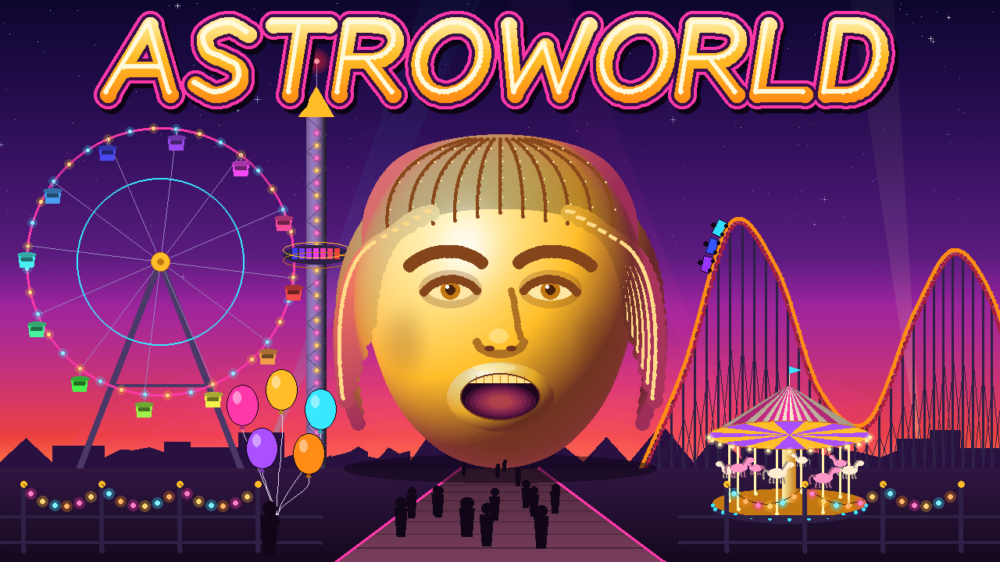
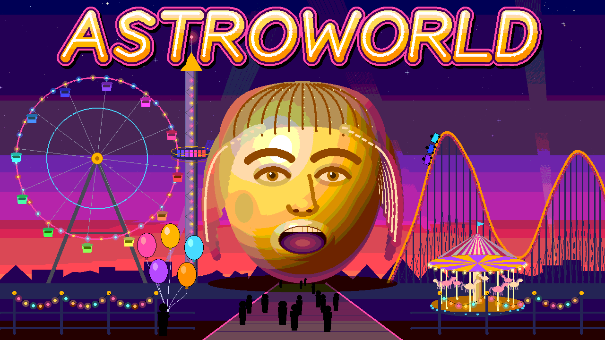

# ASTROWORLD

An animated **ASTROWORLD theme park** built for the Computer Graphics capstone. It captures the full ASTROWORLD feel: the giant golden head as the park's entrance, the retro lettering, a neon sunset, and the rides (Ferris wheel, roller coaster, drop tower, carousel). Every course algorithm is implemented by hand in C++.



---

## Contents

1. [Project roadmap and branches](#project-roadmap-and-branches)
2. [Building and running](#building-and-running)
3. [Project structure](#project-structure)
4. [Course concepts → where they live in the code](#course-concepts--where-they-live-in-the-code)
5. [How the software renderer maps to the rendering pipeline](#how-the-software-renderer-maps-to-the-rendering-pipeline)
6. [Coding conventions](#coding-conventions)
7. [Checkpoint log](#checkpoint-log)

---

## Project roadmap and branches

Each checkpoint has its own branch, created from the previous one, so every stage can be checked out and run exactly as it was submitted.

| Branch | Stage | Focus |
|---|---|---|
| `checkpoint-1` | **CP1 – Technical foundation** | Course algorithms in pure C++, used to build simplified park components. Output: PPM images. |
| `checkpoint-1-window` | CP1 (windowed variant) | The same renderer shown live in a window through a basic windowing library. |
| `checkpoint-2` | **CP2 – Transformation & animation** | 2D/3D transforms with homogeneous matrices; rides animate; frames combined into a video. |
| `checkpoint-3` | **CP3 – OpenGL integration** | Components ported to OpenGL (GLFW + GLAD); real-time camera and perspective projection. |
| `prototype` | Prototype | All components combined into one interactive park. |
| `final` | Final project | Phong lighting, textures, anti-aliasing, ray-traced still, polish. |

---

## Building and running

**Requirements:** a C++17 compiler (g++ 9+ / clang 10+ / MSVC 2019+) and, optionally, CMake 3.16+. CP1 uses **no external libraries**. `ffmpeg` is only used to convert screenshots for this README.

### With CMake

```bash
cmake -S . -B build
cmake --build build
./build/astroworld
```

### Without CMake (single command)

```bash
g++ -std=c++17 -O2 -Wall -Wextra -Isrc $(find src -name '*.cpp') -o build/astroworld
```

### Output

Running `./build/astroworld [outputDirectory]` (default `output/`) writes:

| File | What it shows |
|---|---|
| `astroworldScene.ppm` | The full park scene in 24-bit colour |
| `astroworldScene8Bit.ppm` | Same scene reduced to 256 colours (3-3-2 RGB) |
| `astroworldScene8BitDither.ppm` | 256 colours with 4×4 ordered (Bayer) dithering |
| `algorithmShowcase.ppm` | Every CP1 algorithm shown on its own, labelled |
| `colorShowcase.ppm` | HSV, tints/shades/tones, RGB vs CMYK, colour depth, palette |

PPM files open in GIMP, most Linux image viewers, and VS Code with a PPM extension. To regenerate the PNGs in `docs/screenshots/`:

```bash
./tools/exportScreenshots.sh
```

---

## Project structure

```
src/
├── main.cpp                    CP1 entry point: renders and saves all images
├── core/
│   ├── vec2.h                  2D vector maths, pi, rounding helper
│   ├── color.h/.cpp            RGB/HSV/CMYK conversions, tints/shades/tones, 8-bit reduction, palette
│   ├── frameBuffer.h/.cpp      Pixel memory, spans, alpha blending, dithering, PPM output
│   └── simpleRandom.h          Deterministic xorshift random generator
├── raster/
│   ├── rasterTypes.h           Plot/span callbacks: rasterization kept separate from shading
│   ├── lines.h/.cpp            DDA and Bresenham lines
│   ├── circles.h/.cpp          Midpoint circle (8-way) and midpoint ellipse (4-way)
│   ├── clipping.h/.cpp         Cohen–Sutherland line clipping
│   └── strokes.h/.cpp          Thick lines with round caps (scan-line quad + circle caps)
├── curves/
│   ├── bezier.h/.cpp           Cubic Bézier (Bernstein) and any-degree de Casteljau
│   └── spline.h/.cpp           Catmull–Rom splines (open and closed)
├── fill/
│   ├── scanLineFill.h/.cpp     Edge Table / Active Edge Table polygon fill (even-odd)
│   └── boundaryFill.h/.cpp     4- and 8-connected boundary fill (explicit stack)
├── text/
│   ├── bitmapFont.h/.cpp       5×7 raster font for labels
│   └── astroWordmark.h/.cpp    Vector-stroked "ASTROWORLD" title lettering
├── scene/
│   ├── astroworldScene.h/.cpp  Composes everything into the park (painter's algorithm)
│   ├── backdrop.h/.cpp         Sky, stars, horizon glow, searchlights, skyline, ground, path
│   ├── astroHead.h/.cpp        The golden head
│   ├── goldShading.h           Inflatable-gold surface shader (faux lighting)
│   ├── ferrisWheel.h/.cpp      Ferris wheel
│   ├── rollerCoaster.h/.cpp    Roller coaster track, supports and train
│   ├── dropTower.h/.cpp        Drop tower
│   ├── carousel.h/.cpp         Carousel
│   └── foreground.h/.cpp       Crowd, fence string lights, balloon vendor
└── showcase/
    ├── algorithmShowcase.h/.cpp  Labelled 4×2 grid of algorithm demos
    └── colorShowcase.h/.cpp      Colour-theory demos
tools/exportScreenshots.sh      PPM → PNG for documentation
docs/screenshots/               Checkpoint screenshots
```

---

## Course concepts → where they live in the code

### Hardware and core fundamentals
| Concept | Implementation |
|---|---|
| **Raster vs. vector** | The bitmap font ([bitmapFont.cpp](src/text/bitmapFont.cpp)) is a *raster* font: it goes blocky when scaled. The wordmark ([astroWordmark.cpp](src/text/astroWordmark.cpp)) is *vector*: its letters are described by strokes and curves, so it stays smooth at any size. |
| **Frame buffer** | [frameBuffer.h](src/core/frameBuffer.h): a row-major pixel array, the CPU-side equivalent of the VRAM frame buffer. "Display" means writing it to a PPM file. |
| **CPU vs. GPU** | CP1 rasterizes every pixel sequentially on the CPU. CP3 moves the same work to the GPU, where fragments are processed in parallel. |

### Colour theory and models
| Concept | Implementation |
|---|---|
| RGB / HSV / CMYK | `hsvToRgb`, `rgbToHsv`, `rgbToCmyk`, `cmykToRgb` in [color.cpp](src/core/color.cpp). Demonstrated in the colour showcase. |
| Hue, saturation, value; tints, shades, tones | `makeTint`, `makeShade`, `makeTone`. The Ferris wheel gondolas space their hues evenly around the HSV wheel. |
| Colour harmony | `astroPalette`: a split-complementary scheme of violet/indigo sky against gold/orange, with pink and cyan neon accents. |
| 24-bit → 8-bit reduction | `reduceTo8Bit` / `expandFrom8Bit` (3-3-2 RGB) plus Bayer dithering in `FrameBuffer::reducedTo8Bit`. |
| HSV interpolation | `lerpColorHsv`: the sunset sky gradient goes the short way round the hue circle. |

### Geometric primitives and drawing algorithms
| Algorithm | Where it is used in the park |
|---|---|
| **DDA line** ([lines.cpp](src/raster/lines.cpp)) | Searchlight rays; the clipping demo |
| **Bresenham line** (integer decision parameter) | Ferris wheel spokes, drop-tower lattice, coaster ties and bracing, star sparkles, wire for the string lights |
| **Midpoint circle** (8-way symmetry) ([circles.cpp](src/raster/circles.cpp)) | Ferris wheel rims and hub, light bulbs, eyes, round stroke caps |
| **Midpoint ellipse** (4-way symmetry, two regions) | Carousel platform and canopy, balloons, ears, mouth, horizon glow |
| **Line clipping** (Cohen–Sutherland) ([clipping.cpp](src/raster/clipping.cpp)) | Searchlight rays are 2200 px long and are clipped to the screen before rasterizing |

### Curves
| Concept | Where it is used |
|---|---|
| Parametric curves | Every curve is evaluated as a function of `t ∈ [0, 1]` |
| **Bézier curves** ([bezier.cpp](src/curves/bezier.cpp)) | Dreads, eyebrows, eyelids, nose, braids, the R and D letter bowls, sagging string lights, balloon strings, horse tails |
| **Splines** (Catmull–Rom, [spline.cpp](src/curves/spline.cpp)) | Roller-coaster track, head silhouette, hair cap, the letter S |

### Polygons and area filling
| Concept | Where it is used |
|---|---|
| **Scan-line fill** (ET + AET, even-odd) ([scanLineFill.cpp](src/fill/scanLineFill.cpp)) | Sky, ground, path, head, skyline (highly concave), gondolas, cars, carousel cone |
| **Boundary fill** (4- vs 8-connected) ([boundaryFill.cpp](src/fill/boundaryFill.cpp)) | Balloons. The showcase shows why 8-connected fill leaks through diagonal Bresenham outlines |
| Convex / concave / complex polygons | The showcase fills a concave star and a self-intersecting pentagram (hollow centre under the even-odd rule) |

### Rendering techniques
| Concept | Implementation |
|---|---|
| Painter's algorithm | Scene drawn far to near; carousel horses and crowd members are sorted by depth |
| Fragment shading | `PixelShader` callbacks colour each covered pixel (gradients, stripes, gold lighting) |
| Alpha blending | `FrameBuffer::blendPixel`: glows, beams, contour shadows |
| Lighting (preview) | [goldShading.h](src/scene/goldShading.h) rebuilds an ellipsoid normal per pixel and applies diffuse, specular and rim terms. This is a preview of the full Phong model planned for the final phase. |

---

## How the software renderer maps to the rendering pipeline

| Pipeline stage | In this project (CP1) |
|---|---|
| 1. Application | `renderAstroworldScene` decides what to draw and in what order |
| 2. Vertex processing | Head-unit → screen mapping (`AstroHead::toScreen`), glyph shear, curve evaluation. Replaced by 4×4 matrices in CP2. |
| 3. Primitive assembly | Points become polylines, polygons and ellipses |
| 4. Clipping | Cohen–Sutherland for lines; span clipping and bounds checks in `FrameBuffer` |
| 5. Rasterization | DDA, Bresenham, midpoint circle/ellipse and scan-line fill emit pixels or spans through `PlotCallback` / `SpanCallback` |
| 6. Fragment processing | `PixelShader` functions choose each pixel's colour |
| 7. Output operations | Overwrite or alpha-blend into the buffer; the mouth's teeth discard fragments outside the opening |
| 8. Frame buffer | `FrameBuffer` |
| 9. Display | `savePpm` writes the image file (a live window in `checkpoint-1-window`) |

---

## Coding conventions

- **camelCase** for variables, functions, members and file names (`fillPolygonScanLine`, `astroHead.cpp`). Types use UpperCamelCase (`FrameBuffer`, `RollerCoaster`).
- **Descriptive names**, no single letters, except where the maths itself uses them (`t` for curve parameters, `x`/`y`/`u`/`v` for coordinates).
- **Comprehensive inline documentation**: every file starts with a header comment, every public function has a doc comment, and each algorithm explains its maths (decision parameters, symmetry, edge tables) where the code runs it.
- Screen space: origin at the top-left, x to the right, **y down**.
- Deterministic output: all randomness uses a seeded `SimpleRandom`, so the same frame is drawn every time.

---

## Checkpoint log

### Checkpoint 1 – Technical foundation (pure C++)

**What are we building?**
An animated ASTROWORLD theme park. The giant golden head is both the centrepiece and the entrance. Around it are a Ferris wheel, a roller coaster, a drop tower and a carousel, set against a neon sunset with the retro ASTROWORLD title above.

**What graphics concepts are used?**
Frame buffer and raster vs. vector graphics, RGB/HSV/CMYK colour models, tints/shades/tones, 24 → 8-bit colour reduction, DDA, Bresenham, midpoint circle and ellipse, Cohen–Sutherland clipping, Bézier curves, Catmull–Rom splines, scan-line and boundary fill, and painter's-algorithm layering. Details are in the [table above](#course-concepts--where-they-live-in-the-code).

**What has been completed?**
- A software rasterizer written from scratch: every algorithm above, with no graphics libraries
- Each park component as a self-contained, parameterised struct: `FerrisWheel`, `RollerCoaster`, `DropTower`, `Carousel`, `AstroHead`, plus backdrop and foreground
- The vector "ASTROWORLD" wordmark and a 5×7 bitmap font
- An algorithm showcase and a colour showcase for the checkpoint demo
- 24-bit, 8-bit and dithered 8-bit renders of the scene

| Algorithm showcase | Colour showcase |
|---|---|
|  |  |

| 8-bit (3-3-2) | 8-bit dithered |
|---|---|
|  |  |

**What are we doing next? (CP2)**
- A `Matrix3` / `Matrix4` class for homogeneous-coordinate translation, rotation and scaling
- Rotate the Ferris wheel and carousel, drop the tower seats, run the coaster train along the spline by arc length, bob the horses, twinkle the lights, sweep the searchlights
- Render a numbered frame sequence and combine it into an MP4 with `ffmpeg`
- The components already expose `rotationAngle`, `seatY` and `trainDistance`, so CP2 only has to drive them over time
