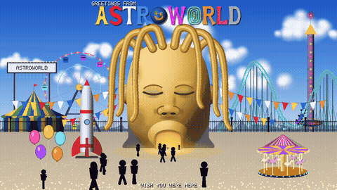
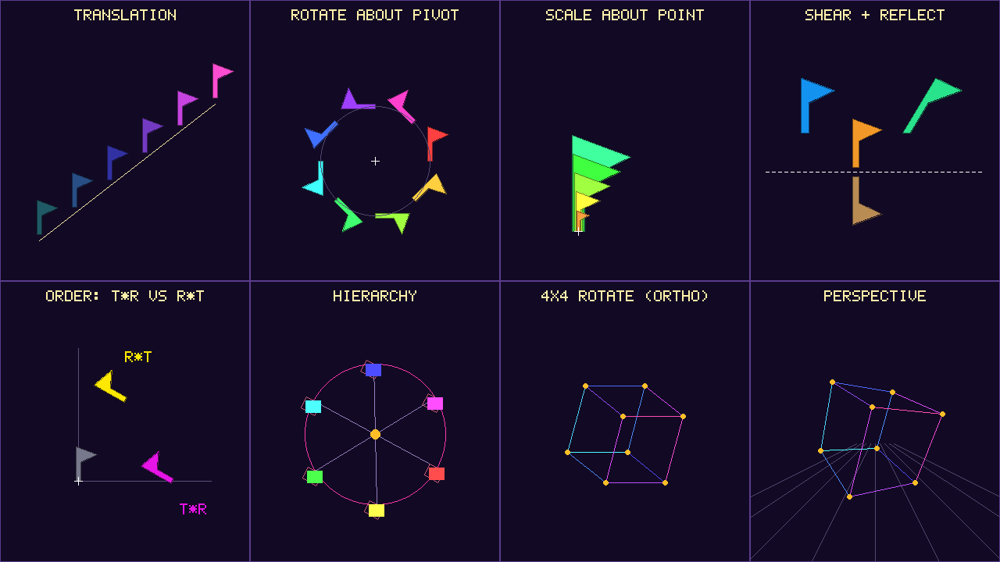

# ASTROWORLD

ASTROWORLD is a theme park built from the art of Travis Scott's *Astroworld* for a Computer Graphics capstone. The giant golden head is the entrance, with its open, glowing mouth as the gate. Around it are the "Greetings from ASTROWORLD" postcard lettering, the blue-sky carnival of the album cover and the starfield of the night artwork. The project starts as a software renderer in which every pixel comes from our own C++ code, and each stage of the course builds on the one before. Every stage lives on its own branch.

This is branch `checkpoint-2`: Checkpoint 2. Later stages are on later branches, and `main` has the latest work.

## Contents

1. [Checkpoint 2: transformation and animation](#checkpoint-2-transformation-and-animation)
2. [Earlier stages](#earlier-stages)
3. [Building and running](#building-and-running)
4. [Course concepts in the code](#course-concepts-in-the-code)
5. [The rendering pipeline](#the-rendering-pipeline)
6. [Project structure](#project-structure)
7. [Coding conventions](#coding-conventions)
8. [Presentation notes](#presentation-notes)
9. [Limitations](#limitations)

---

## Checkpoint 2: transformation and animation

Checkpoint 2 brings the park to life, still in pure C++. A small matrix library places every moving part. `Matrix3` handles 2D homogeneous coordinates and `Matrix4` handles 3D. An animation system of easing curves and keyframe tracks drives a 30-second loop from day through dusk and night to dawn.



**Transformations.**
- Translation, rotation, scaling, shearing and reflection, each available about any pivot.
- The Ferris wheel is a transformation hierarchy whose gondolas hang level.
- Coaster cars rotate to the slope of the track.
- Carousel horses are placed in 3D with 4×4 matrices and depth-sorted.
- The head breathes by scaling about its base, so the mouth stays on the ground.
- The dreads bend about their roots.

The transformation showcase below isolates each operation, including why the order of two transforms matters.



**Animation.** Every frame is a pure function of time, so playback runs at the right speed at any frame rate and any frame can be rendered on its own.
- The drop tower climbs, pauses and falls with a bounce, using keyframes with easing.
- The coaster's speed comes from conservation of energy, integrated along the spline by arc length.
- Gondolas, horses, dreads, balloons and bunting sway on oscillators.
- Visitors walk into the mouth, swinging their legs about the hip.

**Output.**
- Live playback in the window, with pause, seek and speed control.
- Frame sequences with `--animate`, streamed straight into ffmpeg to make an MP4.
- Caching the sky and ground colours per row cut the frame time from about 100 ms to 60 ms.

**Next, for Checkpoint 3.**
- Move to OpenGL and a true 3D park: the same `Matrix4` chain in a vertex shader, a perspective camera, and a depth buffer in place of the painter's algorithm.
- Phong lighting, textures and multisampled anti-aliasing.
- Camera controls.

---

## Earlier stages

Newest first. Each stage is on its own branch, with a README describing it as it stood.

### 1. Checkpoint 1, windowed variant

Branch [`checkpoint-1-window`](https://github.com/Karanei-Kimutai/ASTROWORLD/tree/checkpoint-1-window)

The Checkpoint 1 renderer shown live through SDL2, which only presents the finished frame.


### 2. Checkpoint 1: technical foundation

Branch [`checkpoint-1`](https://github.com/Karanei-Kimutai/ASTROWORLD/tree/checkpoint-1)

The course's raster algorithms written by hand in C++ (lines, circles, ellipses, clipping, curves, fills and colour models) and used to draw the park as still images.


---

## Building and running

**Requirements:** a C++17 compiler (g++ 9+ / clang 10+ / MSVC 2019+) and, optionally, CMake 3.16+. The renderer itself uses **no external libraries**. The live window (`astroworldWindow`) also needs **SDL2** (`sudo apt install libsdl2-dev`); without it CMake skips that target. `ffmpeg` is only used to encode the video and convert screenshots: every pixel is drawn by our own code.

`build/` and `output/` are not tracked by git, so after switching branches they still hold the programs and images of the last branch you built. Rebuild from scratch on each branch:

```bash
rm -rf build && cmake -B build && cmake --build build -j
```

### With CMake

```bash
cmake -S . -B build
cmake --build build
./build/astroworld          # write every still image as a PPM file
./build/astroworldWindow    # play the animation live in a window
./tools/makeVideo.sh        # render the 30 s animation loop to output/astroworldAnimation.mp4
```

### Without CMake

```bash
g++ -std=c++17 -O2 -Wall -Wextra -Isrc $(find src -name '*.cpp') -o build/astroworld
```

### Live window

`astroworldWindow` runs exactly the same pure C++ renderer and plays the animation in real time. SDL2 only handles the last pipeline stage, **display**: each finished `FrameBuffer` is uploaded to a streaming texture (`SDL_PIXELFORMAT_RGB24` has the same byte layout as our `Color`, so nothing is converted) and presented in a resizable, letterboxed window.

Every frame, the real elapsed time (times the playback speed) is added to the animation clock and the scene is rendered for that time. Because each frame is a pure function of time, the motion runs at the right speed at any frame rate, and seeking is instant. A frame takes about 50–70 ms on the CPU (roughly 15–20 fps). That limit is the reason CP3 moves rendering to the GPU.

<details><summary>Controls and options</summary>

| Key | Action |
|---|---|
| `Space` | Play / pause |
| `←` / `→` | Seek −1 s / +1 s |
| `↑` / `↓` | Playback speed ×2 / ÷2 (0.25× to 4×) |
| `1` / `2` | Jump to day (t = 0) / night (t = 18 s) |
| `5` / `6` | Scene reduced to 8-bit / 8-bit dithered (still animating) |
| `3` / `4` / `7` | Algorithm / colour / transformation showcase |
| `S` | Save the current image to `output/window_<view>.ppm` |
| `H` | Show / hide the help overlay (with live FPS) |
| `Esc` / `Q` | Quit |

Command-line options: `--time <seconds>` sets the starting animation time. `--capture <file.ppm>` renders one frame, reads it **back** from the renderer with `SDL_RenderReadPixels`, saves it and exits; add `--with-help` to keep the overlay. The capture at t = 0 matches `astroworld`'s PPM still byte for byte, which shows the window displays the frame buffer exactly.

</details>

### Animation and video

```bash
./build/astroworld --animate <seconds> <fps> <directory>   # frame_00000.ppm, frame_00001.ppm, ...
./build/astroworld --animate 30 30 - | ffmpeg ...          # stream frames on stdout (no files)
./tools/makeVideo.sh [seconds] [fps]                       # MP4 + README GIF preview
```

`makeVideo.sh` pipes the raw PPM frames straight into ffmpeg, so 900 frames (≈2.4 GB of raw pixels) are never written to disk. A full 30 s loop at 30 fps takes about a minute to render.

### Output

Running `./build/astroworld [outputDirectory]` (default `output/`) writes:

| File | What it shows |
|---|---|
| `astroworldDay.ppm` | The park as on the album cover (24-bit colour) |
| `astroworldNight.ppm` | The same park at night: starfield, searchlights, brighter portal |
| `astroworldDay8Bit.ppm` | Day scene reduced to 256 colours (3-3-2 RGB) |
| `astroworldDay8BitDither.ppm` | 256 colours with 4×4 ordered (Bayer) dithering |
| `algorithmShowcase.ppm` | Every CP1 algorithm shown on its own, labelled |
| `colorShowcase.ppm` | HSV, tints/shades/tones, RGB vs CMYK, colour depth, palette |
| `transformShowcase.ppm` | Every CP2 transformation shown on its own, labelled |

To regenerate the PNGs in `docs/screenshots/`:

```bash
./tools/exportScreenshots.sh
```

---

## Course concepts in the code

### Hardware and core fundamentals
| Concept | Implementation |
|---|---|
| **Raster vs. vector** | The bitmap font ([bitmapFont.cpp](src/text/bitmapFont.cpp)) is a *raster* font: it goes blocky when scaled (see the captions). The logo ([astroWordmark.cpp](src/text/astroWordmark.cpp)) is *vector*: its letters are described by curves and polygons, so it stays smooth at any size. |
| **Frame buffer** | [frameBuffer.h](src/core/frameBuffer.h): a row-major pixel array, the CPU-side equivalent of the VRAM frame buffer. "Display" means writing it to a PPM file, or, in the windowed build, uploading it to video memory as a texture (and reading it back with `--capture`). |
| **CPU vs. GPU** | CP1 and CP2 rasterize every pixel sequentially on the CPU: about 60 ms per frame, so the live window manages ~15–20 fps. CP3 moves the same work to the GPU, where vertices and fragments are processed in parallel. |

### Colour theory and models
| Concept | Implementation |
|---|---|
| RGB / HSV / CMYK | `hsvToRgb`, `rgbToHsv`, `rgbToCmyk`, `cmykToRgb` in [color.cpp](src/core/color.cpp). Demonstrated in the colour showcase. |
| Hue, saturation, value; tints, shades, tones | `makeTint`, `makeShade`, `makeTone`. The Ferris wheel gondolas space their hues evenly around the HSV wheel. |
| Colour harmony | `astroPalette`, sampled from the album artwork: complementary blue sky against brass/gold for the day, navy against neon for the night, and a full-spectrum rainbow for the logo letters. |
| 24-bit → 8-bit reduction | `reduceTo8Bit` / `expandFrom8Bit` (3-3-2 RGB) plus Bayer dithering in `FrameBuffer::reducedTo8Bit`. |
| HSV interpolation | `lerpColorHsv`: the sky gradient goes the short way round the hue circle; `nightAmount` blends the day and night palettes. |

### Geometric primitives and drawing algorithms
| Algorithm | Where it is used in the park |
|---|---|
| **DDA line** ([lines.cpp](src/raster/lines.cpp)) | Searchlight rays, concrete joints in the plaza; the clipping demo |
| **Bresenham line** (integer decision parameter) | Ferris wheel spokes, the coaster's lattice truss, fence pickets and rails, star flares, bunting strings |
| **Midpoint circle** (8-way symmetry) ([circles.cpp](src/raster/circles.cpp)) | Ferris wheel rims and hub, light bulbs, the globe, round stroke caps |
| **Midpoint ellipse** (4-way symmetry, two regions) | Carousel, balloons, ears, lips, clouds, glows and soft shadows |
| **Line clipping** (Cohen–Sutherland) ([clipping.cpp](src/raster/clipping.cpp)) | Searchlight rays are 2200 px long and are clipped to the screen; plaza joints are clipped to the ground |

### Curves
| Concept | Where it is used |
|---|---|
| Parametric curves | Every curve is evaluated as a function of `t ∈ [0, 1]` |
| **Bézier curves** ([bezier.cpp](src/curves/bezier.cpp)) | Eyelids, nose creases, the mouth arch, the bowls of R and D, the A's outline, the rocket's nose and fins, the tent roof, sagging bunting, balloon strings |
| **Splines** (Catmull–Rom, [spline.cpp](src/curves/spline.cpp)) | Coaster track, head silhouette, the dreads, the S's spine, teardrop counters, the continents on the globe |

### Polygons and area filling
| Concept | Where it is used |
|---|---|
| **Scan-line fill** (ET + AET, even-odd) ([scanLineFill.cpp](src/fill/scanLineFill.cpp)) | Sky, ground, head, logo letters, skyline (highly concave), tent, rocket, pennants, gondolas, cars |
| **Boundary fill** (4- vs 8-connected) ([boundaryFill.cpp](src/fill/boundaryFill.cpp)) | Balloons. The showcase shows why 8-connected fill leaks through diagonal Bresenham outlines |
| Convex / concave / complex polygons | The showcase fills a concave star and a self-intersecting pentagram (hollow centre under the even-odd rule) |

### 2D and 3D transformations (CP2)
| Concept | Where it is used |
|---|---|
| **Homogeneous coordinates** | [matrix3.h](src/math/matrix3.h): 2D points are `(x, y, 1)` and directions `(x, y, 0)`, so translation is a matrix product like everything else. [matrix4.h](src/math/matrix4.h) does the same in 3D with `(x, y, z, 1)`. |
| **Translation** | Clouds drift (with parallax and wrap-around); visitors walk to the mouth; every model matrix starts with `T(position)` |
| **Rotation** | The Ferris wheel turns about its hub; coaster cars are rotated to the track's slope; pennants flutter |
| **Rotation about a pivot** `T(p)·R·T(−p)` | Dreads bend about their roots; balloons sway about the vendor's hand; walking legs swing about the hip |
| **Scaling about a fixed point** `T(p)·S·T(−p)` | The inflatable head "breathes" about its base so the mouth stays on the ground; visitors shrink to nothing as they step into the light |
| **Composite transforms / order** | `model = S_about(base) · T(center) · S(scale)` for the head; the showcase shows `T·R ≠ R·T` |
| **Hierarchical transforms** | Ferris wheel: `wheel = T(hub)·R(θ)`, `spoke_i = wheel·R(i·30°)`, and gondolas take only the spoke's position so they hang level |
| **4×4 matrices in 3D** | Carousel horses: `Rx(tilt) · Ry(θ + i·45°)` places each horse in 3D; depth (z) sorts them back to front |
| **Shear, reflection** | Transformation showcase (panel 4) |

### Projections (preview for CP3)
| Concept | Where it is used |
|---|---|
| Parallel (orthographic) | Carousel horses are projected by dropping z after the view rotation; the showcase cube uses `Matrix4::orthographic` |
| Perspective, vanishing points | The showcase cube and ground grid use `Matrix4::perspective` and the divide by *w*: parallel grid lines converge on one vanishing point. The plaza joints and crowd scaling imitate one-point perspective. |
| Viewport transform | Normalised device coordinates `[−1, 1]` are mapped to panel pixels (y flipped) |

### Animation (CP2)
| Concept | Where it is used |
|---|---|
| Time-based animation | Every frame is a pure function of `timeSeconds`, so playback is frame-rate independent and any frame can be rendered alone |
| **Keyframes + easing** ([keyframeTrack.h](src/animation/keyframeTrack.h), [easing.h](src/animation/easing.h)) | Drop tower: ease-in-out climb, pause, then a drop that accelerates and bounces (`easeOutBounce`). Day → dusk → night → dawn: smoothstep keyframes over a 30 s loop |
| Physically based motion | Coaster: constant-speed chain lift, then speed from energy conservation `v = √(v₀² + 2g·Δh)`, integrated along the spline by arc length |
| Procedural motion | Sine oscillators for swinging gondolas, bobbing horses, breathing head, swaying dreads, balloons and bunting, twinkling stars and sweeping searchlights |
| Walk cycle | Visitors' legs swing about the hip in opposite phase, with a bounce on each step |

### Rendering techniques
| Concept | Implementation |
|---|---|
| Painter's algorithm | Scene drawn far to near; carousel horses and crowd members are sorted by depth; outer dreads go behind the head, front dreads in front |
| Fragment shading | `PixelShader` callbacks colour each covered pixel (sky gradients, tent and canopy stripes, brass lighting, the portal glow) |
| Fragment discard | Rows below the ground line are discarded when filling the head and lips; continents are discarded outside the globe |
| Alpha blending | `FrameBuffer::blendPixel` and `blendSoftEllipse` (alpha falls off per pixel): clouds, glows, beams, sculpted shadows |
| Stencil mask | [coverageMask.h](src/core/coverageMask.h): letter pieces are *added* and counters *erased* off-screen, then composited |
| **Anti-aliasing** (SSAA) | The logo masks are rendered at 3×3 sub-samples per pixel and box-filtered down, so letter edges are smooth |
| Lighting (preview) | [brassShading.h](src/scene/brassShading.h) rebuilds an ellipsoid normal per pixel and applies diffuse, specular and rim terms. The dreads fake a lit cylinder with three offset tapered strokes. This is a preview of the full Phong model planned for the final phase. |

---

## The rendering pipeline

| Pipeline stage | In this project (CP1 + CP2) |
|---|---|
| 1. Application | `renderAstroworldScene` decides what to draw and in what order |
| 2. Vertex processing | Model matrices (`Matrix3`) move every shape's local points into screen space. Carousel horses go through model → view → parallel projection with `Matrix4`. |
| 3. Primitive assembly | Points become polylines, polygons and ellipses |
| 4. Clipping | Cohen–Sutherland for lines; span clipping and bounds checks in `FrameBuffer` |
| 5. Rasterization | DDA, Bresenham, midpoint circle/ellipse and scan-line fill emit pixels or spans through `PlotCallback` / `SpanCallback` |
| 6. Fragment processing | `PixelShader` functions choose each pixel's colour |
| 7. Output operations | Overwrite, alpha-blend, or stencil-mask into the buffer (SSAA compositing of the logo) |
| 8. Frame buffer | `FrameBuffer` |
| 9. Display | `savePpm` writes the image file, `--animate` streams frames to ffmpeg, and the window uploads each frame to an SDL2 texture |

---

## Project structure

<details><summary>Source tree</summary>

```
src/
├── main.cpp                    Command-line renderer: stills, or animation frames (--animate)
├── windowMain.cpp              Live SDL2 player for the animation (display stage only)
├── core/
│   ├── vec2.h                  2D vector maths, pi, rounding helper
│   ├── color.h/.cpp            RGB/HSV/CMYK conversions, tints/shades/tones, 8-bit reduction, palette
│   ├── frameBuffer.h/.cpp      Pixel memory, spans, alpha blending, dithering, PPM output
│   ├── coverageMask.h/.cpp     Off-screen stencil mask + supersampled (anti-aliased) compositing
│   └── simpleRandom.h          Deterministic xorshift random generator
├── math/
│   ├── matrix3.h/.cpp          2D homogeneous 3×3 matrices: translate, rotate, scale, shear, reflect, pivots
│   ├── vec3.h                  3D vectors (dot, cross)
│   └── matrix4.h/.cpp          3D homogeneous 4×4 matrices: rotations, orthographic and perspective projection
├── animation/
│   ├── easing.h                Easing curves (smoothstep, quad, cubic, bounce), looping time, oscillators
│   └── keyframeTrack.h         Keyframe tracks with per-segment easing
├── raster/
│   ├── rasterTypes.h           Plot/span callbacks: rasterization kept separate from shading
│   ├── lines.h/.cpp            DDA and Bresenham lines
│   ├── circles.h/.cpp          Midpoint circle (8-way) and midpoint ellipse (4-way)
│   ├── clipping.h/.cpp         Cohen–Sutherland line clipping
│   └── strokes.h/.cpp          Thick and tapered strokes (scan-line quads + circle caps)
├── curves/
│   ├── bezier.h/.cpp           Cubic Bézier (Bernstein) and any-degree de Casteljau
│   └── spline.h/.cpp           Catmull–Rom splines (open and closed)
├── fill/
│   ├── scanLineFill.h/.cpp     Edge Table / Active Edge Table polygon fill (even-odd)
│   └── boundaryFill.h/.cpp     4- and 8-connected boundary fill (explicit stack)
├── text/
│   ├── bitmapFont.h/.cpp       5×7 raster font for labels
│   └── astroWordmark.h/.cpp    The ASTROWORLD logo: flared vector letters, globe O, ring O
├── scene/
│   ├── astroworldScene.h/.cpp  Composes the park at any time t; the animation timeline lives here
│   ├── backdrop.h/.cpp         Day/night sky, clouds, stars, searchlights, skyline, fence, plaza
│   ├── astroHead.h/.cpp        The brass head: dreads, closed eyes, nose, glowing mouth portal
│   ├── brassShading.h          Matte-brass surface shader (faux lighting)
│   ├── carnivalProps.h/.cpp    Rocket statue, big-top tent, park sign, bunting
│   ├── ferrisWheel.h/.cpp      Ferris wheel (transformation hierarchy)
│   ├── rollerCoaster.h/.cpp    Roller coaster track, physics-timed train
│   ├── dropTower.h/.cpp        Drop tower
│   ├── carousel.h/.cpp         Carousel (horses placed with 4×4 matrices)
│   └── foreground.h/.cpp       Crowd walking into the mouth, balloon vendor
└── showcase/
    ├── showcasePanel.h           Shared 4×2 labelled-panel layout
    ├── algorithmShowcase.h/.cpp  CP1 algorithm demos
    ├── colorShowcase.h/.cpp      Colour-theory demos
    └── transformShowcase.h/.cpp  CP2 transformation demos
tools/exportScreenshots.sh      PPM → PNG for documentation
tools/makeVideo.sh              Animation → MP4 (and README GIF), frames piped straight into ffmpeg
docs/screenshots/               Checkpoint screenshots
docs/references/                Reference artwork the scene is matched against (local only, not committed)
```

</details>

---

## Coding conventions

- **camelCase** for variables, functions, members and file names (`fillPolygonScanLine`, `astroHead.cpp`). Types use UpperCamelCase (`FrameBuffer`, `RollerCoaster`).
- **Descriptive names**, no single letters, except where the maths itself uses them (`t` for curve parameters, `x`/`y`/`u`/`v` for coordinates).
- **Comprehensive inline documentation**: every file starts with a header comment, every public function has a doc comment, and each algorithm explains its maths (decision parameters, symmetry, edge tables) where the code runs it.
- Screen space: origin at the top-left, x to the right, **y down**.
- Deterministic output: all randomness uses a seeded `SimpleRandom`, so the same frame is drawn every time. Animated parts draw their per-object random values in the same order every frame, so nothing flickers.
- Model space vs. screen space: shapes are defined once in their own local coordinates and placed with a model matrix.

---

## Presentation notes

Speaker notes for this stage are in [docs/presentations/checkpoint2.md](docs/presentations/checkpoint2.md). They cover the brief, a script, and where each piece of work lives in the code.

---

## Limitations

- The park is still 2D. Only the carousel horses use 3D maths, through a parallel projection, and depth comes from the painter's algorithm.
- Rendering is CPU-bound at about 15–20 fps at 1280×720, enough to watch but not for a richer scene.
- The camera is fixed, and lighting is still faked.
